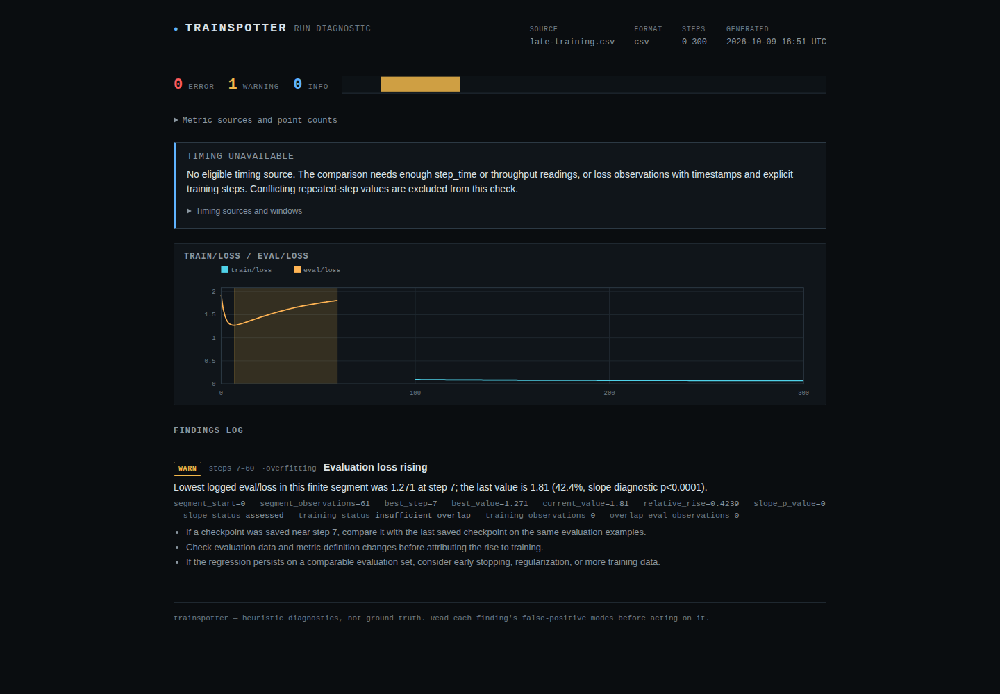
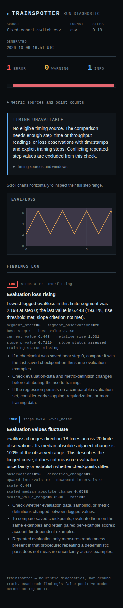

# Evaluation findings need contemporaneous evidence

A log with six perfectly decreasing evaluation losses used to receive
"Eval metric too noisy to rank checkpoints." Median absolute adjacent change
measures movement, including improvement; it is not measurement uncertainty.
An unrelated problem let training loss recorded **after evaluation stopped**
support an "Overfitting onset" claim about the earlier evaluation interval.
Both are repaired in this checkout. The public detector IDs remain
`eval_noise` and `overfitting`.

## A controlled model, not a fitted illustration

The [capture script](../examples/evaluation/capture.py) trains a linear
regression model on 20 synthetic examples and evaluates it on 128 fixed
examples. Its first six evaluation losses decrease from 1.92877 to 1.28281.
The old detector calls their median adjacent change "16%" noise. The repaired
check emits no fluctuation finding for that monotonic sequence.

After step 7, this model's evaluation loss rises while training loss keeps
falling. The full log retains a possible-overfitting finding, with the exact
training and evaluation spans. A derived copy removes training observations
through step 99 and stops evaluation at 60:

```text
optimizer step   0------7----------------60-------100----------------300
retained eval    [minimum, then rising----]
retained train                                    [falling-------------]
shared interval  none
```

The old report still claimed both losses moved "over the same range." The
new report says **Evaluation loss rising**, with `training_status` set to
`insufficient_overlap`. It still reports the observed regression; it cannot
attribute it to contemporaneous training.



Finally, freeze the model at step 300. Repeating the same deterministic
pass 20 times yields the same loss every time. Alternating the full evaluation
set with its 32 highest-loss examples produces loss values 2.19839 and 6.44290,
with **identical model parameters**. Both the aggregate swings and their lack
of a model change are real in this controlled capture. A curve alone cannot
tell changing checkpoint quality from changing evaluation data.

The new fluctuation note describes 18 reversals, explicitly says that it does
not measure uncertainty, and suggests preserving paired per-example scores
when comparing saved checkpoints. Repeating a deterministic pass does not
measure uncertainty across examples either.



## Decision rules and boundaries

`eval_noise` describes a finite segment with at least six observations, at
least two direction reversals (ignoring flat steps), and median absolute
adjacent change at least 15% of its observed range. A monotonic curve or one
valley/peak does not qualify. It is informational. NaN/Inf split segments;
neither the invalid reading nor a change across the gap enters the calculation.
Normalized changes keep the ratio usable for very small or large finite
metrics. Evidence now contains direction counts and normalized range/change,
replacing the misleading `step_noise` and `total_improvement` fields.

`overfitting` assesses only the final finite evaluation segment. If the final
reading is invalid, the separate non-finite finding remains; an earlier
reading is not substituted as the end of the run. "Possible overfitting"
requires a falling training slope and rising evaluation slope **within their
shared interval**, with at least three finite observations of each. The exact
observed bounds, counts, and diagnostic values appear in the report. Nothing
is interpolated. Training after the last evaluation cannot alter that evidence.

Existing relative-rise severity thresholds are retained for nonzero baselines.
Negative losses use the absolute baseline consistently, including the
penultimate-reading guard. Zero baselines have no percentage rise and yield
an informational observation. A failed slope criterion is distinguished from
insufficient observations. Suggestions now condition checkpoint comparisons
on the checkpoint actually having been saved.

These remain heuristics. Selecting a minimum from the same history, serial
correlation, and a normal approximation prevent the OLS p-values from being
calibrated probabilities of overfitting. No cadence correction is attempted.
A small fluctuation ratio does not prove stable evaluation or justify a
checkpoint ranking. A partial training overlap says nothing about the unseen
part of the interval. Different evaluation data can create the same pattern.

## Audit of existing public logs

The [audit](../studies/evaluation-evidence/audit.py) runs both versions of these
two detectors through the same current reader on the existing pinned Hub
manifests. It does not recollect logs, tune thresholds from their outcomes,
or declare a ground-truth overfitting/noise label.

| Quantity | Original collection | Later collection |
|---|---:|---:|
| Manifest entries | 3,208 | 1,051 |
| Readable cached logs | 3,145 | 1,032 |
| Logs with usable evaluation loss | 1,512 | 507 |
| Prior noise findings | 86 | 33 |
| Current descriptive fluctuation findings | 52 | 16 |
| Histories losing the noise finding | 35 | 17 |
| Evaluation-rise findings, before / after | 220 / 221 | 79 / 79 |
| Training attribution removed | 21 | 8 |
| Training attribution added | 1 | 0 |
| Histories with a structural finding change | 59 | 25 |

Across both collections, 29 prior training attributions are no longer supported:
16 lack enough shared observations and 13 do not establish both opposing trends
inside the shared interval. One finite tail after invalid evaluation readings
now supports a rise that the old NaN-poisoned minimum missed. Segmenting that
history also produces two separate fluctuation notes. This explains why 52
histories lose a noise claim while the net finding count falls by 51.

The [retained result](../studies/evaluation-evidence/results.json) includes
revision and source hashes, unavailable entries, every structural change, and
its before/after evidence. 82 manifest entries were unavailable in the cache;
they are not clean runs. Only these two detectors were audited. The historical
full-census accuracy table is not a current accuracy estimate for this repair.

## Reproduce

From a development installation:

```bash
uv run python scripts/verify_evaluation.py --out /tmp/evaluation-check.json --reports /tmp/evaluation-reports
uv run python studies/evaluation-evidence/audit.py --out /tmp/evaluation-audit.json
```

The second command requires the existing `studies/hub-census/cache` files;
the pinned collection instructions are in that study. Capture generation and
its dependencies are [documented separately](../examples/evaluation/README.md).
The independent replay recalculated 16 means from predictions and targets,
with maximum absolute difference 8.89e-16, and checked 40 fixed-model passes.
These are controlled workflow checks, not a general sensitivity or specificity
estimate.

Verification used a clean checkout with a fresh locked installation: ruff and
mypy passed, 419 checks passed, the wheel built from its source distribution,
and the site builder produced nine reports. The seven captured logs also
passed through a fresh wheel installation on Python 3.10.21 with NumPy 1.24.0.
Chromium and Firefox passed 124 report workflows at desktop and 320-pixel
widths, including keyboard use, accessibility, CSP, and zero external requests.
Both retained screenshots were opened and inspected; narrow charts scroll
horizontally while findings wrap. The detector changes remain unreleased on
PyPI. The later [publication verification](publication-verification.md) records
a fresh training capture, audit replay and deployed examples.
