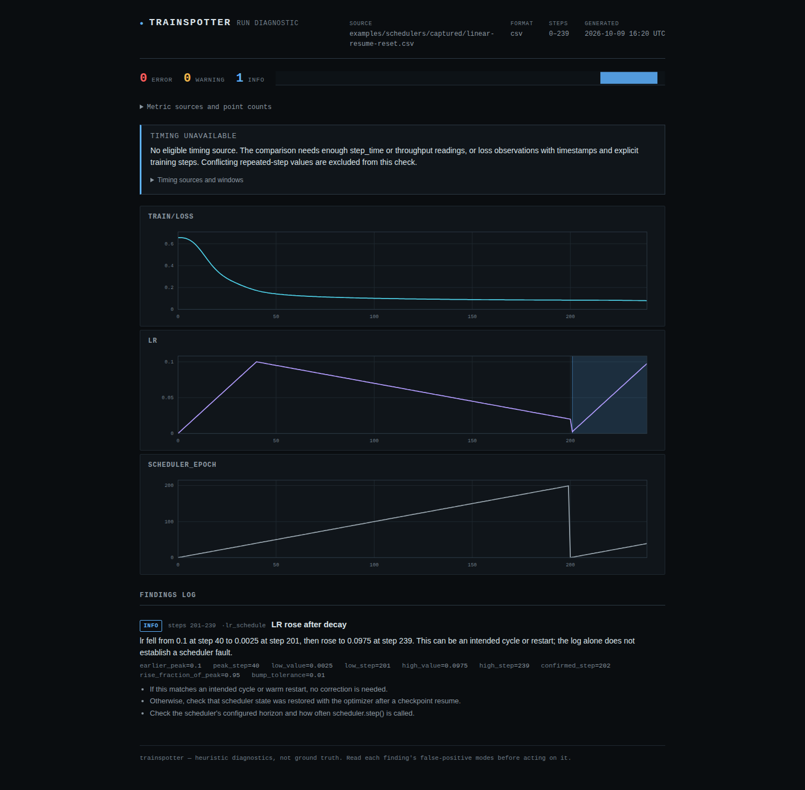

# Learning-rate rises after decay

The source checkout now reports learning rates that decline and then rise,
including a rise that stays below the run's first peak. The previous check
selected the maximum of the *whole* run before looking for anything above it.
That condition could never be true. A separate discontinuity check caught
some abrupt jumps, but smooth rebounds could produce no findings at all.

This is an informational observation. A log alone cannot establish whether the
schedule was intended or whether it harmed training. The correction is local
and unreleased.

## Reproduced with a real optimizer

The [capture script](../examples/schedulers/capture.py) trains a small linear
classifier on fixed synthetic data using PyTorch's SGD optimizer and schedulers.
It records the rate actually applied by each update. It imports no Trainspotter
code. These are controlled experiments, not reports of production incidents.

At update 200, the linear schedule has decayed from `0.1` to `0.02`. Restoring
the optimizer without the scheduler retains `0.02` for that first update, but
the scheduler's next call begins its warmup again:

```text
                         Checkpoint at 200
                                |
             +------------------+-------------------+
             |                                      |
    Restore optimizer + scheduler          Restore optimizer only
    counter remains 200                    counter resets to 0
             |                                      |
    0.0200 -> 0.0195 -> ... -> 0.0005      0.0200 -> 0.0025 -> ... -> 0.0975
    continues the original decay          rises while below the old 0.1 peak
```

The correct-resume run and uninterrupted control have identical observations,
including loss. The omitted-state run previously got **no LR findings**; it now
gets one `LR rose after decay`, with the source peak at 40, low at 201, first
confirmation at 202 and high at 239. All step numbers are zero-based update
indices in these captures. They do not assert a particular logger's convention.



The [375-pixel report](assets/schedulers/resume-mobile.png) uses horizontally
scrollable charts; the finding and numeric evidence wrap within the viewport.

The checkpoint reconstruction initializes the scheduler before restoring the
optimizer, following PyTorch's
[loading guidance](https://docs.pytorch.org/docs/2.8/generated/torch.optim.Optimizer.load_state_dict.html).
The intended control additionally restores the saved scheduler state.

| Captured schedule | Before: LR observations | After: LR observations |
| --- | --- | --- |
| Linear warmup and decay | None | None |
| Correct checkpoint resume | None | None |
| Optimizer restored, scheduler state omitted | None | Rise, steps 201-239 |
| Cosine decay within its horizon | No warmup visible | Same |
| Cosine decay continued beyond its horizon | No warmup visible | Also rise, steps 120-239 |
| Two intended warm restarts | No warmup visible; two discontinuities | No warmup visible; two rises, each reported once |
| One-cycle schedule | None | None |
| Intended step-decay schedule | No warmup visible; one discontinuity | Same |

The overrun uses `CosineAnnealingLR(T_max=120)` for 240 updates. PyTorch's
[documented cosine formula](https://docs.pytorch.org/docs/2.8/generated/torch.optim.lr_scheduler.CosineAnnealingLR.html)
continues beyond its minimum; the captured rate rises smoothly after update
120. Trainspotter does not infer the configured horizon from the log. It
reports the observed reversal and suggests checking the horizon and call cadence.

The sparse captures keep every tenth update. Both problematic schedules still
produce a rise. The omitted-state run's reported low becomes update **200**,
because the lower observation at 201 was not logged. The detector does not
reconstruct hidden minima or exact change times between samples.

## What the check measures

The scan keeps a peak, waits for a material decline, then follows its low point.
A rebound is confirmed when its rise exceeds `bump_tol` (default `0.01`) times
the larger of the preceding peak and the new rate. A decline likewise must
exceed that fraction of its peak. This measures cumulative movement, so a smooth
sequence of small increases can qualify. A zero low is usable: the threshold
is based on a peak, never on division by that low.

The reported episode grows through further increases and small wiggles until
another material decline. Plateaus stay in the same phase. Each episode retains
these numeric JSON evidence fields:

| Field | Meaning |
| --- | --- |
| `earlier_peak`, `peak_step` | Observed peak preceding the decline |
| `low_value`, `low_step` | Last observed low before the qualifying rise |
| `confirmed_step` | First observation that crosses the rise threshold |
| `high_value`, `high_step` | Last maximum reached in that rise |
| `rise_fraction_of_peak` | Rise divided by the larger of the old and new peaks |
| `bump_tolerance` | Configured fraction used for phase changes |

`step_start` and `step_end` locate the low and high on the report's LR chart.
Subsequent observations cannot erase an earlier episode under default settings.
`watch` announces a new episode once, at confirmation; its ordinary suppression
of already reported findings still applies as that episode grows.

An upward discontinuity covered by the same rebound is not repeated as a second
finding. Downward discontinuities retain their separate check. Neither detector
is a validator of an intended schedule, and the existing range-based jump
threshold can miss small absolute steps late in a decay.

## Limits and reproduction

- Intended cyclic schedules and warm restarts are also reversals. Findings stay
  `info` and do not trip `--fail-on warning`. Training-loss detectors retain their
  separate severity rules.
- Non-finite or negative LR observations break the rebound's evidence chain.
  Conflicting values at one step remain excluded by the existing input policy.
  Missing samples have no invented values; a reversal entirely between samples
  cannot be found.
- Initial warmup alone is not a rebound because it has no preceding decline.
  `peak_grace_frac` now defaults to zero. An explicitly nonzero value retains
  the option to ignore lows within an initial fraction of *logged points*;
  this opt-in filter can change its coverage when a log grows.
- The standard detector checks canonical `lr`. Multiple parameter-group metrics
  are not automatically pooled into one schedule. The library's `metric` argument
  can select a particular series.
- The experiment checks one PyTorch version on CPU. It does not estimate the
  frequency or consequences of scheduler mistakes, or prove schedule correctness
  when no rebound is reported.

See the [capture README](../examples/schedulers/README.md) for runnable CLI,
independent replay and recapture commands. The [public-log audit](../studies/scheduler-rebounds/README.md)
measures the additional observations on the existing corpus, preserving unknown
intent and unreadable inputs.

[Verification](scheduler-verification.md) records clean-install checks,
installed-wheel replays, browser evidence and the large-input measurement.
