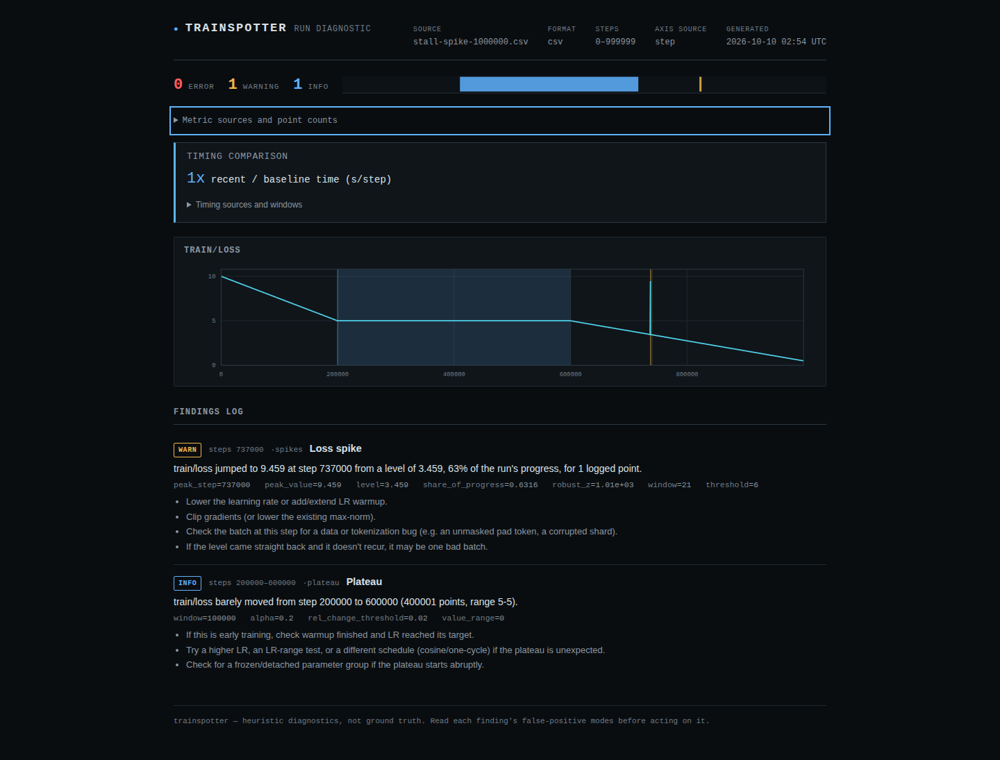

# Long training histories

The source checkout reduces the repeated work in loss analysis. It still
examines every observation: median windows, plateau thresholds, grouping,
convergence suppression, and the spike's preceding-five-point baseline keep
their definitions. No observations are subsampled before diagnosis.

The motivating input had 100,000 observations with a change in logging
cadence. Profiling the preceding implementation (`e218e33`) found about
600,000 separate median calls and 90,001 overlapping OLS fits. The default
regression window contains 10% of the history, so fitting every window from
scratch made this part quadratic in history length.

## Rolling medians

Full windows are reduced in batches using NumPy's read-only
[sliding window view](https://numpy.org/doc/stable/reference/generated/numpy.lib.stride_tricks.sliding_window_view.html).
Each median reduction handles at most 262,144 doubles (2 MiB), or a single
unusually wide user-configured window. The intermediate deviations for MAD
also live in a batch. A million-by-201 copy of every window is never allocated.
The output arrays and the loaded log still grow with observation count.

Initial trailing windows and both ends of centered windows shrink exactly as
before. Even centered-window arguments retain the existing symmetric width
`2 * (window // 2) + 1`. NaN remains a NaN median; it is not silently ignored.
The preceding-five-point spike baseline excludes the current observation.

## Rolling slope decisions

For a window of `w` observations, write `Sxx`, `Syy`, and `Sxy` for the
centered sums of squares and cross-products. The existing normal-approximation
slope test can be rearranged as:

```text
z = inverse_normal_cdf(alpha / 2)
c = z*z / (w - 2 + z*z)

flat slope <=> Sxy*Sxy <= c*Sxx*Syy
```

This avoids forming a residual variance by subtracting two nearly equal
quantities on almost straight lines. Five prefix sums supply the moments of
overlapping windows. Working coordinates are translated and scaled, and
prefixes restart every `max(w, 256)` window starts. A history-wide cumulative
sum would progressively lose small late variations; NumPy also documents
that [`cumsum` rounding differs from pairwise summation](https://numpy.org/doc/stable/reference/generated/numpy.cumsum.html).

Windows containing nonfinite readings are excluded. Exact constant windows
are recognized by counting changes, so a small constant segment beside a
large excursion does not depend on cancellation in its estimated variance.
The existing endpoint-change guard can reject windows before slope fitting.

Cancellation-prone moments and decisions close to the threshold fall back to
a direct fit. The guard propagates conservative prefix-sum error estimates and
adds a margin for coefficient/quantile rounding. The common path is linear;
many difficult windows can still require `O(n*w)` work. This is an accuracy
tradeoff, not a promise of worst-case linear execution.

The direct OLS fit also now translates before centering and uses scaled
coordinates to evaluate residuals. Previously, reconstructing the line from
a large intercept could erase small residuals. This deliberately corrects
numerical results at extreme offsets; it does not introduce a different
statistical test. Adjacent loss readings can remain correlated, and the
slope diagnostic remains a heuristic rather than a calibrated probability
that training has stalled.

## Reproduction

The benchmark generates its synthetic logs from formulas, runs complete CLI
processes sequentially with the same Python and NumPy, records Linux peak
RSS, compares complete JSON output, and checks a known stall and spike.
The million-observation case is run once; the two 100,000-observation cases
are run three times by default. A baseline timeout is recorded explicitly.

```sh
mkdir -p /tmp/trainspotter-before
git archive e218e33 src | tar -x -C /tmp/trainspotter-before
uv run python scripts/benchmark_long_history.py \
  --baseline-source /tmp/trainspotter-before/src \
  --artifacts /tmp/trainspotter-scale --out /tmp/trainspotter-scale.json

node tests/long-history.mjs /tmp/trainspotter-scale/million.html \
  /tmp/trainspotter-scale/stall-spike-1000000-after-0.json
```

The compatibility replay uses the existing revision-pinned public-log
manifests and local cache from [the census](../studies/hub-census/README.md).
It performs no downloads and reports unavailable or unreadable entries
separately. It compares all report fields, allowing only `1e-10` relative or
`1e-12` absolute roundoff in floating-point numbers; names, messages, counts,
severity, and step boundaries must match exactly.

```sh
uv run python scripts/verify_loss_corpus.py \
  --baseline-source /tmp/trainspotter-before/src \
  --artifacts /tmp/trainspotter-corpus --out /tmp/trainspotter-corpus.json
uv run pytest -q tests/test_rolling_statistics.py
```

The numerical checks use sorted-window medians and 80-digit Decimal normal
equations on the exact stored floating-point readings. They cover block
boundaries, missing values, constant stretches, large step jumps, offsets up
to `1e15`, rescaling by `1e-150` and `1e150`, and both sides of the decision
threshold. Compatibility with older output and agreement with an independent
numeric calculation answer different questions; both matter here.

## Inspect the large report

The generated million-observation history falls from 10 to 5, stays exactly
at 5 from step 200,000 through 600,000, then falls to 0.5. A single observation
at 737,000 has 6 added to its loss. These are controlled synthetic features,
not evidence from a production training incident.



[The 320-pixel view](assets/long-history/chromium-mobile.png) keeps the findings
readable and makes the chart horizontally scrollable by keyboard. The HTML
contains no script or external requests. Chart thinning happens only during
rendering and retains each pixel column's extrema; it does not affect findings.
