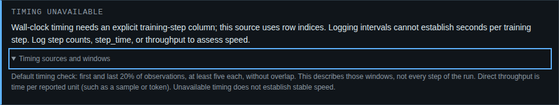
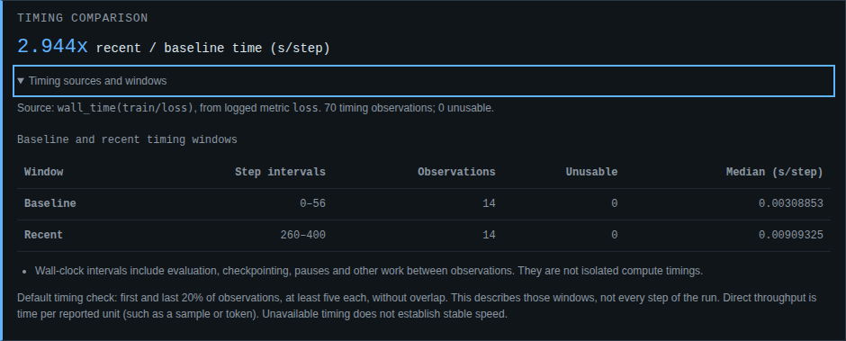
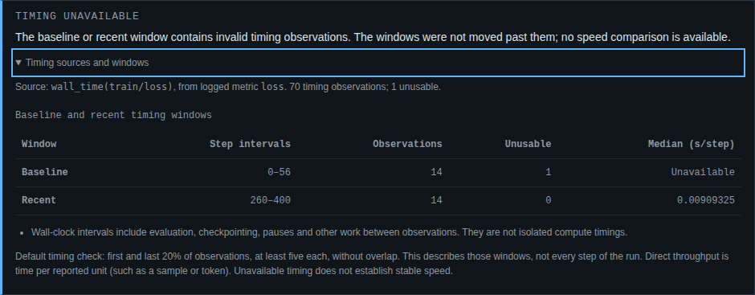

# What supports a throughput warning?

The current source checkout exposes a timing comparison even when it cannot
produce a finding. This behavior and `--require-timing` are unreleased; they
are not in the published 0.2.6 package.

## Logging cadence can look like a slowdown

A CSV with timestamps and loss, but no training-step column, gives the reader
only row positions. In the committed numerical training capture, the logger
changes from every fourth update to every tenth. The previous detector (`9d86d33`)
reported a **2.51x throughput regression** when the step column was omitted.
It divided elapsed seconds by rows, then labelled that seconds per training step.

The same timestamps with their actual training steps produce a ratio of **1.0024**.
Without the step counts, timing is now unavailable. No training speed is inferred
from the logging cadence. Directly logged `step_time` and throughput measurements
remain usable because their time-per-unit values do not depend on row spacing.



The [before/after record](verification-timing-before.json) runs the previous detector
from Git against the exact same captured CSVs and current reader. Its findings are
unchanged on the other six cases; only the false cadence alarm disappears.

## Inspect the source and windows

Reports include a **Timing comparison** or **Timing unavailable** section. Open
**Timing sources and windows** in the offline HTML report to inspect the original
metric name, the chosen source, observation counts and baseline/recent windows.
The two window rows retain unusable observation counts; a bad window has no median.



Source priority is unchanged:

| Source | Required observations by default | Compared quantity |
| --- | ---: | --- |
| `step_time` | 10 analysis points | Recorded seconds per step |
| `throughput` | 10 analysis points | Reciprocal of each recorded rate, in seconds per reported unit |
| `train/loss` timestamps, then `eval/loss` timestamps | 11 analysis points and explicit steps | Elapsed seconds divided by actual step advance for each interval |

Windows contain the first and last 20% of timing observations, at least five
each, without overlap. An eligible higher-priority source with broken window
values stays unavailable; it does not silently fall back to a more convenient
source. A source with too few points may use the next source, and the reason is
recorded. A loss series with any missing timestamps is not used for derivation;
intervals are not bridged over holes. Nonpositive or nonfinite derived timings
stay unusable in their original windows. Unusable interior observations outside
the two windows are counted and noted without moving either window.

The JSON report adds `timing` to schema version 1. `status` is `compared` or
`unavailable`; an unavailable comparison has `ratio: null` and a `reason`.
`source_metric` records the original logged metric. `axis` distinguishes `step`
from `row_index`. Window `first_position` and `last_position` follow that axis;
for wall-clock derivation, `interval_start_step` also records where the first
interval began. Counts, settings and notes are included. Numerical evidence is
finite or null, so standard JSON parsers can read it.

The later [W&B axis repair](wandb-axes.md) also distinguishes `logging_step`:
W&B's `_step` and default chart `Step` do not establish training progress.
`run.step_column` names the selected counter and `run.step_selection` records
automatic versus explicit selection. Direct durations/rates remain usable on
a logging axis; wall-clock seconds per training step require training coordinates.

Report timing evidence always uses the default window settings. Library callers
using a customized `ThroughputDetector` can call `assess_timing(run, min_window=...,
baseline_fraction=...)` for its corresponding windows. Findings retain their own
actual evidence. The report does not claim the default-window panel reflects a
custom detector configuration.

## Require usable timing in a gate

```sh
# The captured delay: report written, warning, exit 1.
uv run trainspotter analyze examples/timing/slow-with-steps.csv \
  --output html --out /tmp/slow-report.html --fail-on warning --require-timing

# Missing step counts: report written, timing unavailable, exit 2.
uv run trainspotter analyze examples/timing/stable-without-steps.csv \
  --output json --fail-on warning --require-timing
```

`--require-timing` requires complete input and an available timing comparison.
It controls availability; `--fail-on` controls finding severity. A slowdown does
not cause exit 1 with `--require-timing` alone. `watch --require-timing` stops with
exit 2 when a loaded run cannot support a comparison, including during early
training with too few readings. Leave it off to continue watching such a run.

| Captured case | Recent / baseline time | `--fail-on warning` | Also `--require-timing` |
| --- | ---: | ---: | ---: |
| Stable training, actual steps | 1.0024 | 0 | 0 |
| Same observations, step column removed | Unavailable | 0 | 2 |
| Injected late delay, actual steps | 2.9442 | 1 | 1 |
| Directly measured update durations, row axis | 2.9439 | 1 | 1 |
| The same durations as sample throughput | 2.9439 | 1 | 1 |
| One timestamp removed | Unavailable | 0 | 2 |
| One timestamp moved backwards | Unavailable | 0 | 2 |

Input completeness concerns readable data. Missing optional timestamps or a clock
that runs backwards can leave usable loss readings while making timing unavailable.
Without `--require-timing`, those cases do not fail solely because timing is unavailable.



## Captures and verification

The [experiment inputs](../examples/timing/README.md) come from two actual numerical
training loops, on synthetic data, with deliberately paced updates and an injected
late delay. All 802 observations, CSV transformations, runtime versions and input
hashes are retained. These are controlled demonstrations, not production incidents.

[`verify_timing.py`](../scripts/verify_timing.py) imports no Trainspotter modules.
It checks every CSV reading against the captured observation, computes time per
step and window medians with the Python standard library, invokes the real CLI,
and checks report values, source units and exit codes. A failed timing gate must
still emit the same complete JSON report.

```sh
uv sync --locked --all-extras --dev
uv run python scripts/verify_timing.py --capture examples/timing \
  --reports /tmp/timing-reports
uv run ruff check src tests examples scripts
uv run mypy src
uv run pytest -q
uv build
npm ci
TRAINSPOTTER_TIMING_SCREENSHOTS=docs/assets/timing \
  TRAINSPOTTER_BROWSER_EVIDENCE=docs/verification-timing-browser.json npm run test:browser
uv run python scripts/build_site.py
```

- [Source CLI and independent calculations](verification-timing.json).
- [Fresh wheel on Python 3.10 and NumPy 1.24.0](verification-timing-wheel-minimum.json).
- [Fresh wheel on Python 3.14 and NumPy 2.5.3](verification-timing-wheel-current.json).
- [Offline Chromium and Firefox report workflows](verification-timing-browser.json),
  including screenshot hashes, keyboard disclosure/table scrolling, 320px layout,
  accessibility checks, and no network or policy violations.

Screenshots were opened and inspected: the three figures above,
[Firefox](assets/timing/firefox-slow-with-steps.png), and
[320px mobile](assets/timing/mobile-slow-with-steps.png). Narrow tables scroll inside
their focusable region; the mobile view explicitly says to scroll for all columns.
The generated gallery includes the cadence, delay and broken-clock reports.

The full Python run passed 380 checks; 80 generated-report workflows passed across
Chromium and Firefox at desktop and 320px widths. Lint, strict type checking,
wheel/source distribution builds and the nine-report site build passed. The
installed-wheel checks exercise the actual CLI entry points in fresh environments,
including `--require-timing`; runtime versions and the installed timing module's
hash are recorded separately from the verifier's Python version.

A [100,000-observation scale check](verification-timing-scale.json) used a synthetic
988,905-byte timing-only CSV and the installed Python 3.14 wheel. One fresh process
produced JSON in 0.60 s at 58,944 KiB peak RSS; another produced the 57,711-byte HTML
report in 0.66 s at 68,656 KiB. Both retained the exact window endpoints and reported
the expected 3x ratio with exit 1. This is one local measurement on 14-logical-CPU
WSL2 Linux, not a throughput guarantee. The record includes the generator, input
hash, wheel hash and measurements.

## Limits

The comparison describes two windows, not the entire run. It does not detect every
temporary slowdown, infer the cause, or estimate a confidence interval. Its threshold
remains the existing 1.4x default. Wall-clock intervals include checkpointing,
evaluation, pauses and other work between observations. Times are assumed to be
seconds; throughput units follow what was logged. Batch-size or sequence-length
changes can change time per reported unit without an infrastructure problem.
Early warmup can distort the baseline. A constant clock scale error is not detected.

Unavailable timing is evidence of a limit, not evidence of stable speed. The captures
check the data path and arithmetic; their injected sleeps are not a GPU benchmark.
