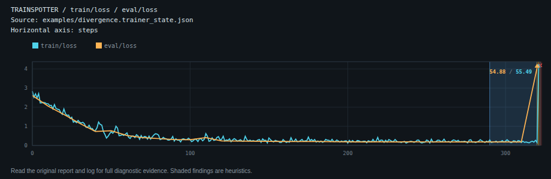

# Share a chart without a screenshot

Generate an HTML report with the source checkout:

```bash
trainspotter analyze examples/divergence.trainer_state.json --output html --out report.html
```

Open it from disk and choose **Download SVG** beside a chart heading. The
saved vector opens independently, scales in a narrow window and keeps its
own palette and labels. The HTML report and download require no JavaScript,
server, CDN or network connection.



[Actual vector file](assets/vector-charts/recorded-divergence.svg) and
[its retained CairoSVG PDF conversion](assets/vector-charts/recorded-divergence.pdf).
This is a retained controlled training capture deliberately made to fail,
not an independent training or diagnostic-accuracy result.

The visible caption identifies the source path and horizontal axis. A logging
counter stays **logging steps**; it does not become training progress. An
incomplete input or an excluded conflicting trajectory stays visible in the
export. A fully excluded chart has no SVG download. Source paths and metric
names are included, just as in the report.

The SVG reuses the already drawn chart. It keeps gaps, singleton observations,
NaN/Inf markers, off-scale labels, finding bands and display thinning. It does
not add a new diagnosis, infer missing readings, or recover raw points removed
for display. Keep the original report and log for complete diagnostic evidence.

A `metadata` element carries JSON with `format: "trainspotter-chart"` and
`schemaVersion: 1`: supplied source/run identity, axis kind/label/source,
requested/plotted/excluded metrics, original source labels, input completeness
and input notes. An unavailable axis source stays null. These are recorded
labels and declarations, not authenticated provenance. Visible long names are
abbreviated; metadata retains their full values.

The output uses the [SVG namespace and standalone document structure](https://www.w3.org/TR/SVG2/struct.html#Namespace)
and embeds its shared report palette and SVG rules. System fonts are used;
font metrics can differ on another machine. The export resolves its own
palette to literal CSS values and uses generic font families. Screen sizing
stays inside a screen media rule, leaving explicit dimensions for static
converters. Colored off-scale values have explicit text positions. Chromium,
Firefox and CairoSVG 2.8.2 are checked; physical printers were not measured.

The script-free link embeds a second copy of the vector in the HTML. This
increases file size: the 200,000-observation control grows from 99,272 to
218,040 bytes while retaining bounded display geometry. The size check now
allows 300,000 bytes for that control, still far below a path containing all
200,000 points. Input notes and completeness are computed once per report
rather than rescanned for each downloadable chart.

[Native captures, exact curve compatibility, actual offline downloads,
standalone rendering, file sizes and limitations](../studies/vector-charts/README.md).
The PyPI 0.2.6 release predates this source feature.
