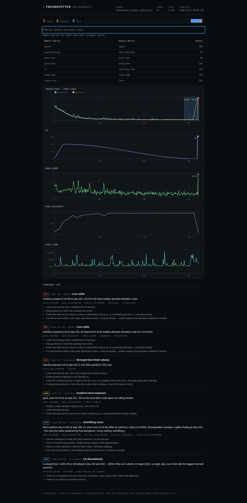
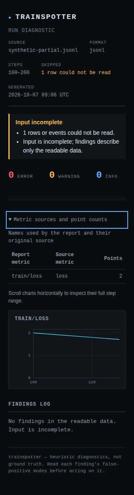

# Input integrity verification - 2026-10-07

Source commit `038c62b` was verified from a fresh detached checkout. The changes
are local and unreleased; no source push, Pages deployment or registry upload was
performed. This document and the screenshots are subsequent evidence-only additions.

The work addresses failures that could change a diagnosis: erased TensorBoard
history, unread tensor scalars, invented step coordinates, merged metric identities,
incomplete input passing a gate, and unsupported numeric conclusions. The original
150-test suite passed before this audit; the expanded suite contains 315 tests.

## Checks performed

| Environment/check | Result |
|---|---|
| Python 3.10.21, minimum direct dependencies, NumPy 1.24.0, TensorBoard 2.12.0 | 315 passed |
| Python 3.12.12, fresh `uv sync --locked --all-extras`, NumPy 2.5.3, TensorBoard 2.21.0 | 315 passed |
| Python 3.14.7, fresh current dependencies | 315 passed |
| `uv run --locked ruff check src tests examples scripts` | Passed |
| `uv run --locked mypy src` | Passed, 25 source files |
| `uv build` | Source distribution and wheel built successfully |
| Wheel installed outside the source tree, Python 3.10.21 + NumPy 2.2.6 only | Nine format/gate checks passed; missing input and missing extra returned 2 without tracebacks |
| Fresh Node 24.21.0 `npm ci` and `npm run test:browser` | 36 workflows passed |
| `uv run --locked python scripts/build_site.py` | Index and six real-example reports built |
| Working tree after clean-checkout checks | Clean |

The browser matrix covers all six real-example reports, synthetic partial input,
hostile/long/colliding metric names, and an ordinal-axis input, in both Chromium and
Firefox at 1440px and 320px. It checks keyboard expansion of source tables, keyboard
chart scrolling, no page overflow, strict JSON companions, no injected script, and
zero axe WCAG A/AA/best-practice violations. It observed no page errors, CSP violations
or HTTP(S) requests. These are generated reports opened from disk, not hosted-site tests.

The committed `baseline` and real `transformers_tinygpt2` logs still produce zero
findings. The divergence, overfitting, missing-warmup, and throughput-drop examples
retain their expected pathologies. Restart tests use TensorBoard's event writer and
an independent scalar accumulator. The tensor oracle uses equivalent exactly
representable scalar encodings; it is not a comparison with the modern plugin
accumulator. The [input contract](input-integrity.md) explains the distinction.

## Visual review

The established dark report style is retained. Original metric names are available
in a keyboard-operable disclosure. Incomplete input has an amber notice before the
counts, and its empty findings section no longer reads as a clean result. Charts
scroll horizontally on phones so axis labels remain readable. The screenshots show
the disclosure open and its keyboard focus indicator; they were inspected directly.

## Evidence and limits

[Machine-readable verification](verification-2026-10-07.json) records the environment
matrix and artifact hashes. [Browser case results](verification-browser-2026-10-07.json)
record each tested report/layout/browser combination.

This pass did not run a live TensorFlow/Keras or PyTorch training job. The event-file
tests use TensorBoard's writer and protobufs, while the existing real Transformers
log remains a regression fixture. Diagnostics remain heuristics, not a complete audit
of training health. Large concurrent logs, unmarked restarts, repeated step numbers,
and renamed event files retain the limits documented in the input contract.

The static site build is `uv run --locked python scripts/build_site.py --out-dir site`,
with `site/` as the output directory. The verified source and those generated pages
have not been published.
