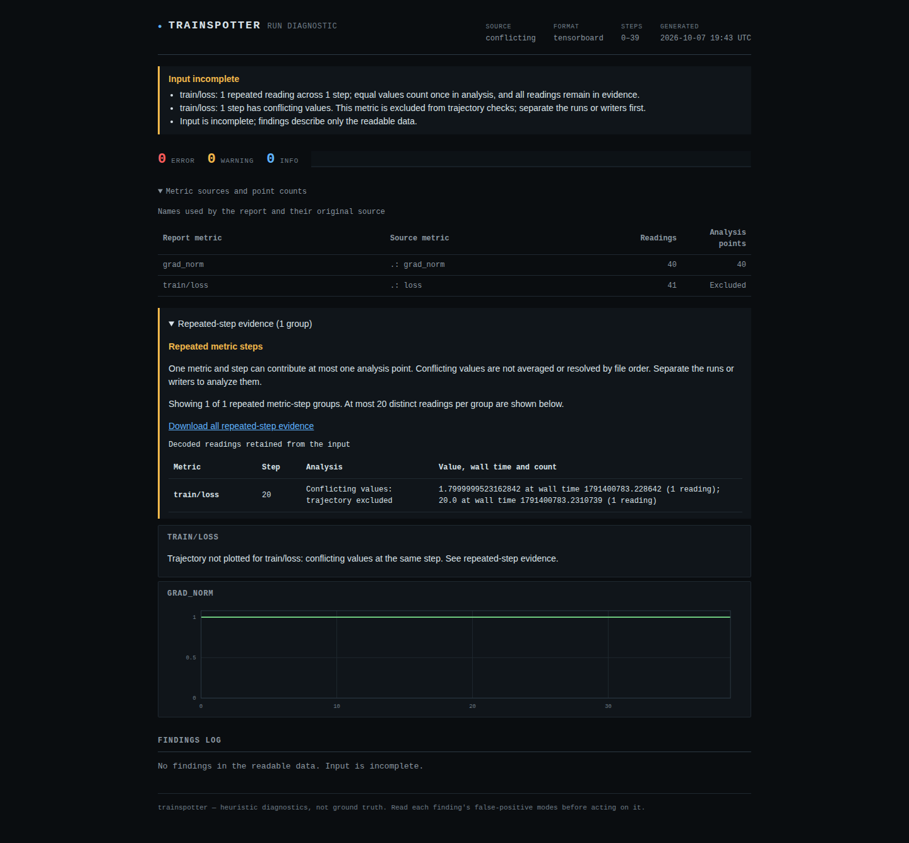
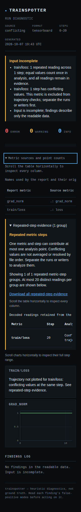
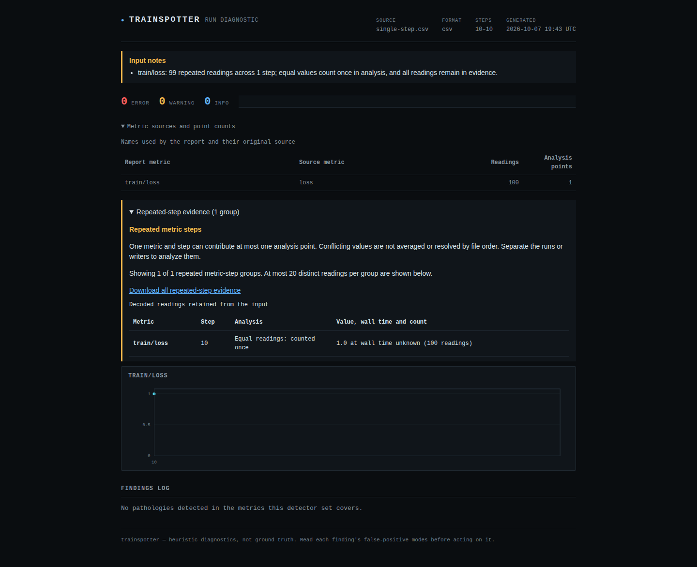

# Repeated-step evidence verification - 2026-10-07

Source commit `44b3f1b` was verified in a fresh detached checkout. It is local and
unreleased; the published package still has its earlier behavior. No source push,
package upload or website deployment was performed.

## The counterexample and resulting behavior

The former implementation diagnosed a plateau at steps 10-10 when a CSV contained
100 copies of `step=10, loss=1`. There was only one observed training step. The new
implementation retains 100 readings, contributes one analysis point and produces
no plateau. Its chart displays one marker instead of an invisible one-point path.

| Controlled input | Retained loss readings | Analysis points | Result |
| --- | ---: | ---: | --- |
| One CSV observation repeated 100 times | 100 | 1 | Complete input, no findings, gate exit 0 |
| 40 TensorBoard events each written three times | 120 | 40 | Complete input; repetitions do not increase sample size |
| 40 events plus a conflicting loss at step 20 | 41 | 0 for loss | Incomplete input; gate exit 2; independent gradient-norm series retained |
| 50 CSV/JSONL/HF observations, ten NaNs, plus a conflicting loss | 51 | 0 for loss | Ten non-finite readings reported as observed facts; gate still exits 2 |

The TensorBoard examples use its real `EventFileWriter` and are compared with its
independent `EventAccumulator` for every retained `(step, value, wall_time)` tuple.
They are controlled scalar-event captures, not model-training measurements. Their
timestamps measure producer execution; the replayed capture has a throughput
finding from that artificial timing, and consequently its warning gate exits 1.
There is no claim that this capture represents a healthy training run.

Both the ordinary `analyze` command and `watch --once` were exercised as actual
processes. Conflicting values are neither averaged nor resolved by file order.
Equal values with conflicting timestamps still permit value-only checks while
their time remains unknown. Sparse train/eval rows stay separate by metric.

## Package and browser verification

| Check | Result |
| --- | --- |
| Fresh Python 3.12.12, `uv sync --locked --all-extras`, NumPy 2.5.3, TensorBoard 2.21.0 | 325 tests passed; Ruff and mypy passed |
| Python 3.10.21, lowest direct dependencies, NumPy 1.24.0, TensorBoard 2.12.0 | 325 tests passed |
| Source distribution and wheel from the clean checkout | Built successfully |
| Wheel installed outside the checkout, Python 3.10.21 and NumPy only | Nine real command workflows passed, including missing optional dependency handling |
| Fresh Node 24.21.0 install; Chromium and Firefox | 52 offline HTML workflows passed |
| Static-site generation | Six existing real-example reports and index built successfully |

The installed-wheel checks cover CSV, JSONL and HF conflicts in `analyze` and
`watch`, incomplete-input precedence over an error finding, the one-step CSV,
standalone HTML generation, and the missing TensorBoard extra. The verification
script ran outside both source trees and imported the installed wheel.

The browser matrix opens generated HTML from disk at 1440px and 320px. It exercises
keyboard disclosures, table/chart scrolling and focus; downloads the actual
repeated-step JSON in both engines; and compares every downloaded record with the
CLI JSON companion. A 150-conflict input displays 100 groups while exporting all
150. Each visible group shows at most 20 distinct readings with explicit omission
text; exports retain all decoded values and counts.

All 52 browser cases had zero axe A/AA/best-practice violations, page errors, CSP
violations and HTTP(S) requests. The report contains no script. Hostile metric
names remain inert. A requested light color scheme is included in the matrix;
the report intentionally retains its established dark visual theme.

The desktop and mobile screenshots were inspected directly. Numeric columns have
room for complete labels, tables scroll inside the page, and ambiguous loss has
an explanation in place of a guessed curve.

## Evidence and limits

[Machine-readable results](verification-repeated-2026-10-07.json) contain the
source commit, package/capture hashes, environment, process outcomes and browser
matrix summary. [Per-browser results](verification-repeated-browser-2026-10-07.json)
record every report/layout/engine combination.

The inspectors bound rendered rows, not total input memory: all readings and the
complete downloadable evidence are retained. Conflicting values exclude an entire
metric from trajectory checks; this is deliberately conservative because the file
does not identify a trustworthy continuation. Observed non-finite loss readings
remain findings even in that excluded metric. Input completeness is not detector
coverage or proof of training health. See [the behavior guide](repeated-steps.md)
and [input integrity contract](input-integrity.md) for recovery and restart semantics.
