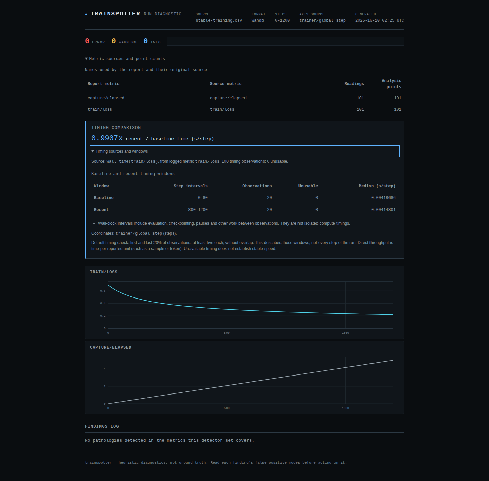
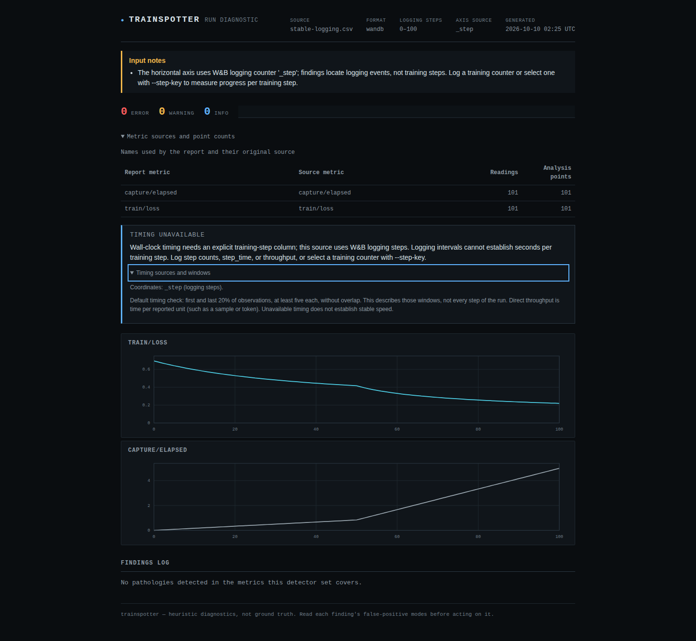
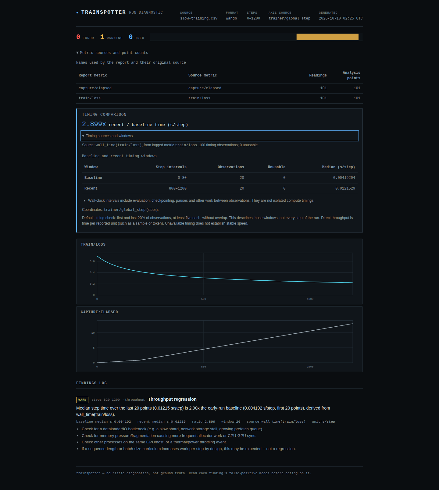

# A logging counter is not a training-step counter

This fix is local and unreleased. Install the source checkout to use `--step-key`.

The previous checkout (`9e988eb`) divided W&B `_runtime` intervals by `_step`.
In the [retained offline SDK experiment](../examples/wandb-axes/README.md), steady
training therefore appeared to slow down **4.95x** when logging changed from
every 4 updates to every 20. The CSV already contained `trainer/global_step`;
the reader treated it as an ordinary metric and ignored it as a coordinate.

W&B documents [custom logging axes](https://docs.coreweave.com/products/wandb/track/log/customize-logging-axes)
separately from its default logging counter. `define_metric` can attach a logged
metric to a separate coordinate. CSV exports do not retain that complete mapping.

```text
Training update    0   4   8  ... 200  220  240 ... 1200
SDK _step          0   1   2  ...  50   51   52 ...  100
                         same update speed
Log interval         4 updates       20 updates
```

The reader now uses a recognized training counter when there is one unambiguous
candidate. Reports name the selected axis. Without a training counter they retain
logging positions, and per-training-step wall-clock timing is unavailable.
Recorded `step_time` or throughput remains usable: those values already state
time per unit and do not depend on coordinate spacing.



## Measured result

The two controlled runs performed real numerical updates on synthetic data,
with measured clocks and deliberately injected sleeps. These are not production
incidents or GPU benchmarks. The same captured inputs were run through the old
checkout and the changed source.

| Capture | Old time ratio | Corrected time ratio | Independent update-clock ratio |
| --- | ---: | ---: | ---: |
| Steady update pacing, changing logger interval | 4.9536 | 0.9907 | 0.9911 |
| Deliberate late delay, same logger change | 14.4952 | 2.8990 | 2.9027 |
| Steady capture, training counter removed | 4.9536 | Unavailable | Same underlying observations |

Exact numbers and window endpoints are retained in
[verification-wandb-axes.json](verification-wandb-axes.json). The verifier checks
202 SDK history records and 2,402 per-update observations; it computes interval
medians with the Python standard library and invokes the real CLI in subprocesses.
It imports no Trainspotter code. W&B's own clock and the independent capture clock
are close but are taken at different instants; exact agreement is not assumed.



## Select a coordinate

| Input | Automatic selection | Explicit selection |
| --- | --- | --- |
| W&B history | One of `trainer/global_step`, `train/global_step`, `global_step`, or separate `step`; otherwise `_step` as logging positions | `--step-key` names an exact column |
| W&B chart | `trainer/global_step`, `train/global_step` or `global_step` are training coordinates; default `Step`/`_step` are logging positions; other axes use row indices | Must name the first column: the exported chart has one shared axis |
| CSV, JSONL, Lightning | Existing `step`, `global_step`, `iteration`, `iter` rules; otherwise row indices | `--step-key` names an exact column |
| HF Trainer JSON, TensorBoard | Their recorded native steps | `--step-key` is rejected: these inputs have no selectable column |

Names in automatic selection are case-insensitive and tolerate surrounding
whitespace. Explicit names match exactly. Several recognized W&B training
counters require a choice, even if they currently agree. The selected coordinate
is not duplicated as a metric.

```sh
uv run trainspotter analyze examples/wandb-axes/slow-custom.csv \
  --step-key optimizer/updates --output html --out /tmp/wandb-slow.html \
  --fail-on warning --require-timing

uv run trainspotter watch examples/wandb-axes/slow-custom.csv \
  --step-key optimizer/updates --once --fail-on warning --require-timing
```

Both commands exit **1** for the recorded slowdown. Without `--step-key`, this
custom name is an ordinary metric, `_step` supplies logging positions, and
`--require-timing` exits **2**. Exit 2 means the requested timing evidence is
unavailable; it does not mean training is healthy or slow.

For the library, use `load_run(path, step_key="optimizer/updates")`. The tabular
readers accept the same keyword. `run.step_column`, `run.step_axis` and
`run.step_selection` in JSON retain the coordinate source, kind (`step`,
`logging_step`, `row_index`) and selection (`automatic`, `explicit`). Timing
windows, finding ranges and chart labels use that coordinate system.

If your logger deliberately calls `run.log(..., step=optimizer_step)`, you can
select `--step-key _step`. This is your assertion about the logger. The reader
cannot distinguish that usage from ordinary logging counters based on a CSV.
Reports retain an explicit-selection note so the assertion stays visible.

Missing, fractional, nonfinite or out-of-range selected values are skipped and
counted. A row never falls back to `_step`, row number or a previous counter
value. Missing training coordinates can make input incomplete and fail a gate.
Multiple readings at a selected step retain the existing repeated-step rules:
conflicting values/timestamps are evidence to resolve, not extra progress.

## Reproduce and inspect

```sh
uv run python scripts/verify_wandb_axes.py --reports /tmp/wandb-axis-reports
uv run python scripts/build_site.py
```

The first command checks all six derived CSVs, including both automatic and
explicit handling of custom counters, JSON gate exits and generated HTML.
The second builds `site/`, including three new SDK examples with the exact CSV
embedded for offline download. This build does not publish the site.

The browser checks exercise Chromium and Firefox at desktop and 320px widths:
coordinate labels, timing disclosures, keyboard scrolling, accessibility,
no external requests and no CSP violations. Full checks, installed-wheel evidence
and screenshot review are recorded in the [verification record](verification-wandb-axes.md).



## Limits

The field name is a convention, not proof of the meaning of a counter. Explicit
selection trusts the caller. All metrics in a loaded run share one selected axis;
exports with independent per-metric counters should be separated before analysis.
CSV does not preserve the SDK's complete `define_metric` configuration, sampling
policy, or step-sync history. No missing values are reconstructed. Chart bands
remain excluded, and a chart export alone does not establish unsmoothed raw history.

Wall-clock intervals include logging, evaluation, checkpoints and pauses. A speed
change is not a diagnosis of its cause. The default comparison covers its first
and last windows, not every interval or every transient slowdown. The retained
SDK capture is pinned to W&B 0.22.3; no claim of a live server-export test is made.
