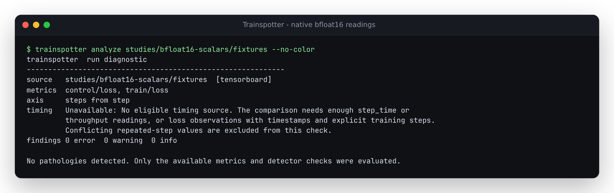

# Native bfloat16 scalar readings stopped being unreadable

At baseline `7eebb62`, all five bfloat16 `train/loss` readings in this native
TensorFlow capture became `None` with five skipped events. The float32 controls
loaded correctly. TensorFlow's own decoder read the original event bytes as
`1`, `0.5`, `0.25`, `0.125` and `0.10009765625`.

The capture uses TensorFlow 2.20.0's
[low-level summary writer](https://www.tensorflow.org/api_docs/python/tf/summary/write)
with scalar-plugin metadata and bfloat16 tensors. These are synthetic constants,
not a trained model or evidence about training quality. Ordinary
`tf.summary.scalar` casts to float32 and is not the affected producer path.

TensorBoard's bundled NumPy stub cannot decode the bfloat16 dtype. The source
reader now widens each recorded 16-bit scalar payload directly to float32,
without a TensorFlow runtime dependency. It handles both `tensor_content`
bytes and a single repeated `half_val` bit pattern. Scalar shape is checked
before decoding, and malformed or missing payloads remain unreadable rather
than becoming an assumed zero. NaNs, infinities and signed zero remain
observations. Other tensor dtypes keep their existing SDK decoder.

| Native capture | Baseline | Corrected |
| --- | --- | --- |
| Five bfloat16 loss readings | Five unreadable values | All five match TensorFlow's numeric oracle |
| Float32 controls | Five readable values | Identical values |
| Recorded `0.1` input | Unreadable bfloat16 value | Retains quantized `0.10009765625`; does not recover the original decimal |
| Analyze/watch warning gates | Exit 2: incomplete input | Exit 0 for this valid finite capture |

The [unmodified 754-byte event file](fixtures/events.out.tfevents.native)
has SHA-256 `702db370bb51cf132a66b774d1e7987a660daebd4ea8383e5b2f2825ba7d1e54`.
The [native capture receipt](results/native-capture.json) retains the actual
dtype identifiers, payload bytes, step numbers and TensorFlow-decoded values.
[Before](results/before.json) disagrees in all six library, JSON/HTML and
CLI/watch workflows; [after](results/after.json) disagrees in none.

## Reproduce

```sh
uv sync --locked --extra dev
uv run --no-sync python studies/bfloat16-scalars/replay.py --src src --out /tmp/bfloat16.json
```

Export `7eebb62` to another directory and pass its `src/` to that replay with
`--observe-only`. The replay checks product import origin, hashes the runtime
reader and original event bytes, invokes the actual CLI in a separate working
directory and retains its full JSON/terminal captures. Single-file CLI calls
use the existing explicit `--format tensorboard` option.

To generate a new native capture and exhaustive numeric oracle independently:

```sh
uv run --no-project --python 3.12 --with tensorflow-cpu==2.20.0 python studies/bfloat16-scalars/capture.py --out /tmp/new-bfloat16-capture --all-words
```

Use a new output directory. Event timestamps and filenames vary; numerical
expectations are reproducible. The permanent producer reproduced all original
numeric expectations and the exhaustive oracle bytes in this session.

The [all-pattern oracle receipt](results/all-words-oracle.json) identifies a
TensorFlow `make_ndarray` decode of all 65,536 bfloat16 bit patterns, widened
to float32 and retained as a small [compressed table](fixtures/native-all-words.f32le.gz).
Both scalar payload encodings match its numeric values, including negative
zero, infinities and NaNs. NaN payload/signalling distinctions are not part of
the Python numeric comparison. This is codec coverage, not 65,536 training runs.

The regressions also check missing/short/long binary data, absent/duplicate or
out-of-range half values and a non-scalar shape. They keep these readings
unavailable and counted as skipped. This does not expand support to arbitrary
tensor shapes or reconstruct pre-quantization values.

## Installed artifact verification

The [verification receipt](results/verification.json) records code commit
`522fcba`, wheel/source-archive hashes, all matched runtime files and check logs.
A fresh archive passed the repository's configured lint/type checks plus the
new study lint, 671 Python tests with no skips, package and sample-site builds,
and 208 Chromium/Firefox offline report workflows, including keyboard,
accessibility and 320px checks. The site build produced 17 sample reports.

| Installed environment | Native library/CLI workflows | Decoder regressions |
| --- | --- | --- |
| Python 3.14.7 / NumPy 2.5.4 / TensorBoard 2.21.0 | [Six; zero disagreements](results/installed-current.json) | 14 passed |
| Python 3.10.21 / NumPy 1.24.0 / TensorBoard 2.12.0 | [Six; zero disagreements](results/installed-floor.json) | 14 passed |
| Python 3.12.12 / core wheel only | Baseline HF example passed; TensorBoard and TensorFlow absent | Not a TensorBoard run |

The older SDK installation uses `setuptools<81` for its `pkg_resources`
dependency. Both TensorBoard installations have no TensorFlow installed.
All 29 runtime files, including `py.typed`, match the clean source, wheel,
source archive and all three installations.

The [offline browser replay](results/browser/browser.json) checks actual
exported reports in both engines at 1440 and 375px. Loss readings change from
zero to five and the unreadable curve becomes a plotted trajectory; float32
controls remain visible. All eight before/after screenshots were inspected.
The phone layout keeps its existing horizontal table/chart scrolling hints.
The [terminal capture](../../docs/assets/bfloat16-scalars.ansi) comes from the
installed current CLI analyzing the native fixture directory.



Two verification-harness adjustments are retained. The first all-pattern
prototype tried `make_tensor_proto` on an eager bfloat16 scalar and hit a NumPy
conversion error; the oracle now uses an explicit TensorFlow protobuf and its
decoder. The first browser selector matched both incompleteness and unreadable
evidence headings; it now selects the existing `input-heading` id. Neither
adjustment is a product renderer or upstream TensorFlow compatibility fix.

The source correction has no corresponding PyPI release or verified hosted
deployment. Package build: `uv build`. Existing sample-site build:
`uv run python scripts/build_site.py`, producing `site/`.
