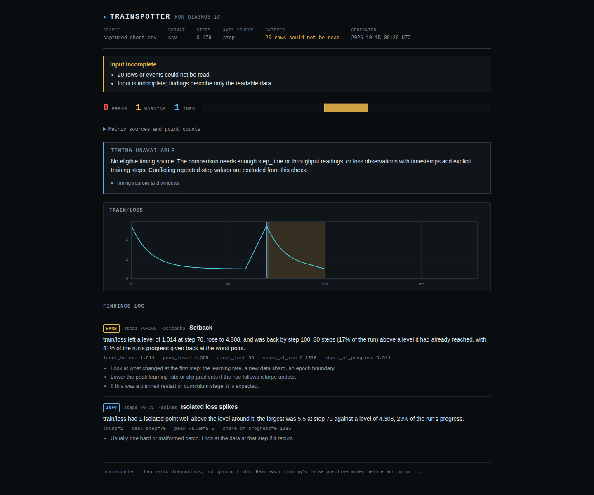
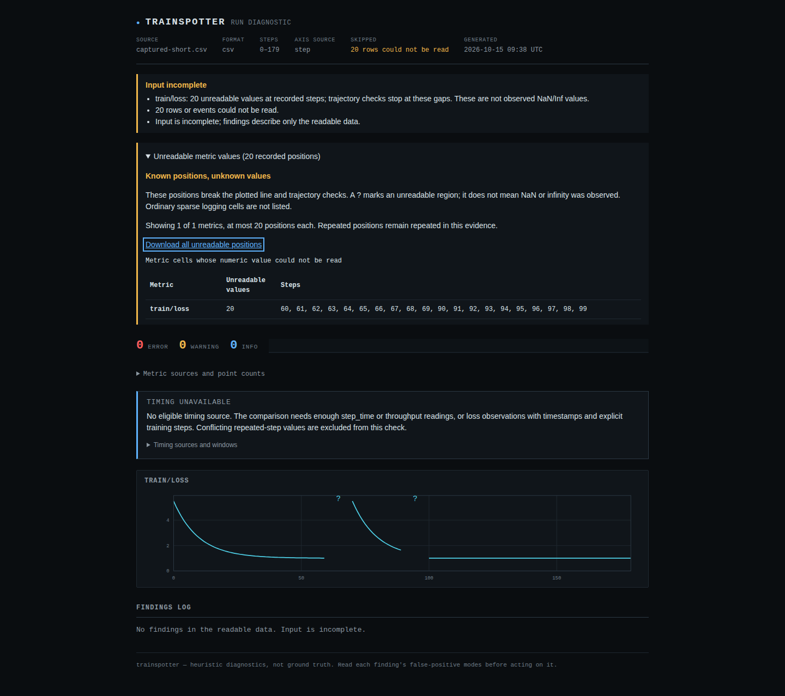
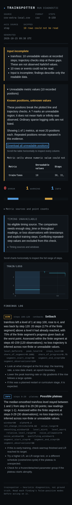

# Rejected CSV rows still locate unknown observations

At baseline `71d76a3`, a short or extra-width CSV row was counted and discarded
before its readable coordinate reached the analysis model. That connected the
observations on either side: loss rises and spikes could be invented across
missing evidence, and a genuine event inside a later segment could disappear.

The repair keeps an unknown value at the readable step for each recognized or
otherwise numeric metric. It trusts neither the malformed row's metric cells nor
its clock. Generic CSV, Lightning CSV, W&B history and W&B chart exports all use
this rule. Custom text-only columns remain metadata.

## Actual CLI counterexample

The input starts with the retained [controlled CPU PyTorch experiment](../finite-segments/README.md).
Its 180-observation log has 20 deliberately recorded NaN cells from empty logging
reductions. This study applies an **artificial CSV export fault** only to those
20 rows: remove the loss field, or append one extra field. Every other row stays
byte-identical. This is a derived fixture, not a new training capture or a claim
about the frequency of damaged exports.

| Derived input | Baseline | Repaired source |
|---|---|---|
| 20 short rows with readable steps | Setback at 70-100; isolated spike at 70-71 | No loss-trajectory findings; 20 unknown positions |
| 20 extra-width rows with readable steps | Same unsupported findings | Same retained boundaries |
| Original observed NaN capture | Non-finite training loss, count 20 | Identical finding; actual NaNs remain observations |

Both malformed inputs already returned **2** under `--fail-on error` before this
repair and still do. The defect was an unsupported diagnosis across known data
loss, not a falsely passing input-integrity gate. The original NaN control returns
1 because its otherwise readable input contains an observed error.





## Controls and retained evidence

[`replay.py`](replay.py) invokes the real JSON and HTML CLI for 44 cases. Besides
the two derived captures, it writes labelled synthetic rise, spike, setback and
valid-later-event patterns in five layouts, each with short and extra-width rows.
A fully readable finite control retains its setback at steps 60-80.

| Check | Baseline | Repaired source and both installed wheels |
|---|---:|---:|
| Unsupported trajectory findings in the 32 cross-gap cases | 34 | 0 |
| Valid later setbacks at steps 100-120 in 10 local-event cases | 0 | 10 |
| Malformed cases returning input-error gate status | 42 of 42 | 42 of 42 |
| Original NaN observations reported | 20 | 20 |

The later setback's evidence names the finite segment at steps 40-159; its
20-step duration is measured within that segment. Possible plateaus are separate
findings and can still occur within individually supported flat segments.

- [Before](results/before.json) and [after](results/after.json): complete JSON
  reports, exact input hashes, exit codes and generated HTML hashes.
- [All 66 pre-existing tracked CSV controls](results/controls-before.json):
  complete report hashes or explicit reader rejections. All 65 reports and one
  rejection match [after](results/controls-after.json) and on the
  [minimum-dependency installed wheel](results/controls-wheel-minimum.json).
  These include retained native captures, public loss exports, deliberately
  adversarial fixtures and synthetic examples; they are not 66 independent runs.
- [Installed minimum wheel](results/wheel-minimum.json): Python 3.10.21,
  NumPy 1.24.0, no optional TensorBoard dependency. All 44 complete JSON reports
  match the repaired source.
- [Installed current wheel](results/wheel-current.json): Python 3.14.7,
  NumPy 2.5.4, no optional TensorBoard dependency. The same 44 reports match.
- [Artifact receipt](results/artifacts.json): 29 runtime files, including
  `py.typed`, match byte-for-byte in source, sdist, wheel and both installations.
  A clean archive at `af85879` passes lint, mypy, all **733 tests**, and sdist/wheel
  builds on Python 3.14.7. The 51 focused regression cases also cover invalid
  steps, sparse cells, custom metrics, decimal commas, BOMs and ordinal chart axes.
- [Real live watch](results/watch-source.json) and
  [installed minimum wheel watch](results/watch-minimum.json): an ordinary pipe
  receives the unknown-position notice while the process stays alive. Completing
  the file clears the input warning, invalidates prior history and delivers the
  newly supported rise. No unbuffering override or mocked watch loop is used.
- [Offline browser before](results/browser-before.json) and
  [after](results/browser-after.json): two actual CLI-generated HTML reports in
  Chromium and Firefox at 1440px and 375px, eight workflows per version. Fresh
  offline contexts open local files, inspect broken paths and finding titles,
  and keyboard-download the exact unknown coordinates. No external requests,
  page errors, CSP violations, horizontal page overflow or axe violations.
  Screenshots were inspected; wide charts and evidence tables scroll internally.

The broader `node tests/browser.mjs` run from the clean archive did **not**
complete: Firefox closed during `checkKeyboardScroll`, after repeated native
Juggler `NS_ERROR_FAILURE` messages. An earlier working-tree attempt terminated
with status 143. Neither is counted as a passing full browser suite. The focused
eight-report-workflow check above completed in both engines; broader browser
runner stability remains unresolved. [Run limitation](results/browser-full-limitation.json).



[`scaling.py`](scaling.py) measures loading 1,000, 10,000 and 100,000 rows with
10% rejected records on a 14-vCPU WSL2 Linux host with 48 GB RAM. Three samples per
size are retained [before](results/scaling-before.json) and
[after](results/scaling-after.json). The 100,000-row medians were 3.07s and 2.93s.
Other workloads were active and the smaller samples were noisy; these establish
the measured completion cost, not a speedup or an isolated performance estimate.

## Replay

From the repository root, with a writable scratch directory:

```bash
uv run python studies/csv-row-gaps/replay.py --source . --verify \
  --out /tmp/csv-row-gaps.json --artifacts /tmp/csv-row-gap-reports
uv run python studies/csv-row-gaps/controls.py --source . --out /tmp/csv-controls.json
uv run python studies/csv-row-gaps/watch.py --source . \
  --out /tmp/csv-watch.json --artifacts /tmp/csv-watch
node studies/csv-row-gaps/browser.mjs /tmp/csv-row-gap-reports \
  /tmp/csv-browser.json verify /tmp/csv-screenshots /tmp/csv-row-gaps.json
```

For a separate baseline archive use `--source /path/to/baseline` and omit
`--verify`. To test an installed artifact, use `--python /path/to/venv/bin/python`
and omit `--source`. Each subprocess removes inherited `PYTHONPATH` before
selecting the requested source or installation. Browser dependencies come from
`npm ci`; the checked-in harness uses the already installed browsers.

## Boundaries

A parseable selected coordinate still relies on the header's field positions;
this does not reconstruct a shifted or damaged CSV. An invalid explicit step
locates nothing and is never replaced by an ordinal. Row-index sources retain
their disclosed ordinal axis. Blank physical lines ignored by a CSV reader do
not acquire invented records.

Complete-width sparse cells remain absent observations. Explicit unreadable
scalar cells, row-shape rejections, actual NaN/Inf readings and unknown coordinates
remain distinct. Rejected rows stay in `skipped_rows`, with no invented numeric
measurements and no additional `skipped_values` cell count. Multiple metrics may
therefore have an unknown position from the same rejected row. No JSONL or
TensorBoard reader semantics change in this repair.

These are source and local-artifact checks. No PyPI release or hosted-demo
deployment was performed for this repair.
