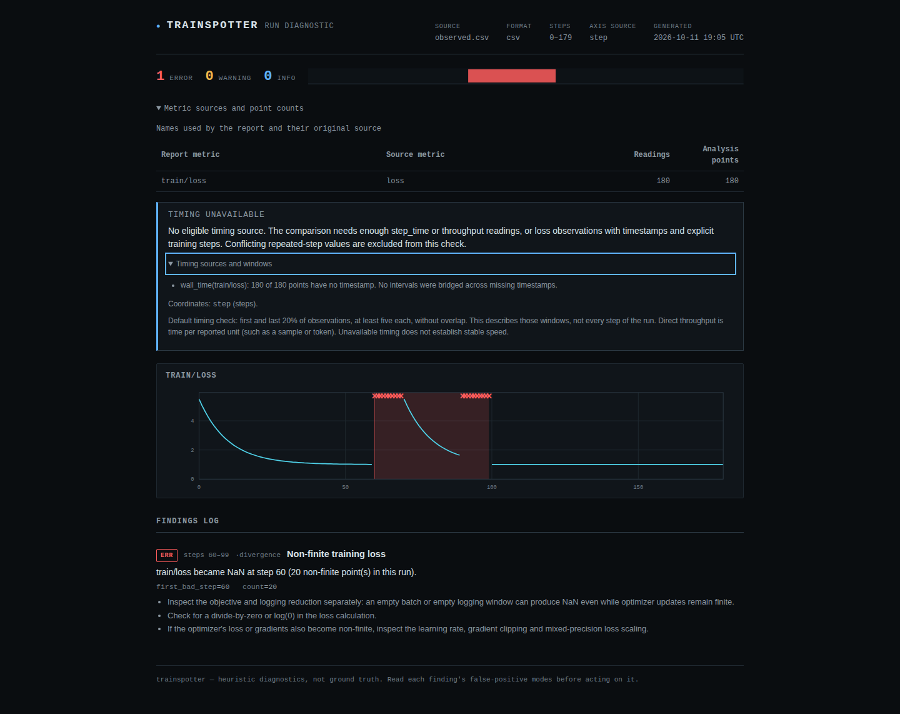

# A logging gap cannot establish a loss trajectory

The previous source discarded NaN/Inf before estimating loss levels. That
joined separate finite stretches into one curve: a level after a gap could
become a spike, a recovered setback could acquire an invented duration, and
a log ending in NaN could be described as ending at its earlier finite level.

The retained [CPU PyTorch capture](captured/capture.json) demonstrates the
problem with actual optimizer and logging operations. It is a controlled
experiment, not a production incident. It minimizes `1 + w**2 / 2` using
float64 SGD, starting at `w = 3` with learning rate 0.05. Two deliberate empty
tensor means make the *logged* loss NaN while the objective remains finite.
A saved weight is restored during the second logging gap.

```text
step       59     60 ... 69     70 ... 89     90 ... 99     100 ...
weights    save                 reset to 3    restore at 95
log        finite |   NaN   |      finite    |   NaN   |   finite
analysis          boundary                  boundary
```

[objective.csv](captured/objective.csv) retains actual objective and weight;
[observed.csv](captured/observed.csv) is exactly what Trainspotter receives.
The old report asserted a setback at steps 70-100 costing 30 steps, and an
isolated-spike finding at 70-71. The true restore occurred at 95, and the log
cannot reveal that recovery endpoint. Its earlier baseline is also separated
from the rise by a gap. The corrected report retains the non-finite error
without those trajectory claims.

The title is now **Non-finite training loss**, since the recorded NaN does
not establish whether training or only logging failed. This does not weaken
the error gate: the capture still exits 1 with `--fail-on error`.

## Before and after

[before.json](before.json) was run against source commit
`a714805` and [after.json](after.json) against the correction. Each retains
actual CLI findings, input hashes and exit codes. Apart from the producer
capture, these are explicitly synthetic boundary/control examples generated
by [replay.py](replay.py).

| Input | Previous trajectory claim | Corrected trajectory claim |
| --- | --- | --- |
| PyTorch capture with two logging gaps | Setback 70-100; isolated spikes 70-71 | None across gaps |
| Constant levels 1 and 3 separated by NaN | Rose from start, 0-109 | None across gap |
| Finite rise followed by NaN tail | Did not recover, ending at earlier step 79 | No finite terminal level |
| First high reading after gap | Spike at 70 | No preceding local baseline |
| Two five-point segments | Rose from start, 0-10 | Too little finite evidence |
| Complete recovered event after a gap | Missed | Setback 100-120, within segment 40-159 |
| Rising final segment after a gap | Rose from start, 0-99 | Rise confined to 50-99 |
| Finite control with a recovered event | Setback 60-80 | Same setback 60-80 |

All NaN examples retain their non-finite alert. Tests additionally cover
positive and negative infinity, true spikes on both sides of a gap, and
all-nonfinite input. A later finite segment is still analyzed; the detector
does not discard the whole run simply because it contains one bad reading.



The browser check also opens the positive after-gap example on a narrow
screen: [320px screenshot](../../docs/assets/finite-segments/chromium-mobile-synthetic-after-gap.png).
It verifies that the retained setback displays its actual segment bounds and
`share_of_segment`, rather than labelling the fraction as a share of the run.

## Reproduce

From the source checkout, without installing PyTorch:

```sh
uv sync --locked --all-extras --dev
uv run --locked python studies/finite-segments/replay.py --out /tmp/finite-after.json --artifacts /tmp/finite-cases --verify
uv run --locked trainspotter analyze studies/finite-segments/captured/observed.csv --fail-on error
```

The last command intentionally exits 1. The replay checks capture hashes,
then independently checks every captured weight/objective against the closed
form `w = 3 * 0.95**k`, with the reset and restore selecting `k`. No detector
output is used to define this oracle. To replay a separately installed wheel,
add `--executable /path/to/venv/bin/trainspotter` to the second command.

To reproduce the producer in a separate environment:

```sh
uv venv --python 3.12 /tmp/finite-capture-env
uv pip install --python /tmp/finite-capture-env/bin/python torch==2.8.0+cpu --index-url https://download.pytorch.org/whl/cpu
/tmp/finite-capture-env/bin/python studies/finite-segments/capture.py --out /tmp/finite-recapture
```

Choose an empty output directory. The retained run used Python 3.12.12 and
PyTorch 2.8.0+cpu; capture needs no model, dataset or GPU. PyTorch is not a
Trainspotter dependency.

## Existing-log compatibility

[corpus.json](corpus.json) compares complete reports for 4,259 cached,
revision-pinned public Hub records: 4,177 readable and 82 unreadable. Of these,
4,233 records are exactly equal, including the 82 unreadable records. The
remaining 26 reports change only the non-finite title and/or suggestions.
No trajectory, severity, finding count or input-completeness state changes
in this corpus. [corpus-review.json](corpus-review.json) identifies and hashes
each changed input; [review_corpus.py](review_corpus.py) asserts those limits.
This is compatibility evidence, not proof of detector accuracy or a new live
Hub survey. The defect demonstration is the controlled capture above.

With the existing census cache and a copy of the previous `src/`:

```sh
uv run --locked python scripts/verify_loss_corpus.py --baseline-source BASELINE_SRC --artifacts /tmp/finite-corpus --out /tmp/finite-corpus.json
uv run --locked python studies/finite-segments/review_corpus.py /tmp/finite-corpus /tmp/finite-corpus-review.json
```

The comparison command exits 1 when reports differ, including the expected
wording changes. The second command checks that every change is accounted for.
The recorded full replays took 239.3 and 252.8 seconds on the same WSL2 host
while other verification ran; these are not an isolated performance benchmark.

## Scope

An explicit NaN/Inf is a boundary. Sparse blanks/nulls remain absent readings;
there is no reliable way to infer a logging outage from an unrecorded value.
Within each finite segment, the original heuristic still applies: at least
ten observations, local smoothing/scatter/progress, and the same thresholds.
Findings name segment bounds and duration fractions. They do not establish
optimizer health, the cause of a rise, or wasted GPU time. Other detectors
retain their own policies; plateau findings, for example, are not relabelled
by this change. See the [input contract](../../docs/input-integrity.md).

These are local source changes. No PyPI release, tag, push or hosted-gallery
deployment was performed.
