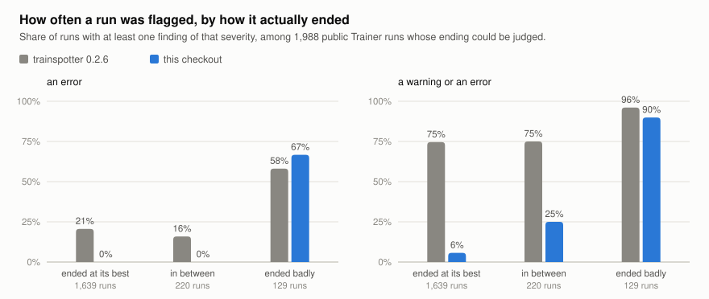

# What 3,145 public training runs look like, and what that did to trainspotter

`transformers.Trainer` writes its whole logging history to `trainer_state.json`
in every checkpoint directory, and many people upload those directories to the
Hugging Face Hub along with the model. That makes thousands of real training
logs public. This study collects them, runs trainspotter over every one, and
compares what it said with how each run actually ended.

**What came out**

- **The released detectors cried wolf.** trainspotter 0.2.6 raised a warning or
  an error on 75% of the runs that ended at their best loss, and an error on
  21% of them. Of the 615 runs it gave an error, 12% had ended badly. It
  averaged 17 findings per run.
- **They were tuned on smooth generated curves.** A logged training loss is one
  mini-batch's average, and its scatter is heavy-tailed. The spike detector
  alone fired on 37% of all runs, 17 times each; the gradient-norm detector on
  40%, 24 times each.
- **After recalibrating on this corpus**, a run that ended at its best loss gets
  an error 0% of the time and a warning 6% of the time; a run that ended badly
  gets a warning or an error 90% of the time. 72% of errors are now on runs that
  ended badly, and none on runs that ended at their best. The average is 0.9
  findings per run.
- **About public fine-tuning itself:** one run in five with an evaluation loss
  ended at least 5% above its best evaluation loss, and one in twenty at least
  50% above. A fifth of the runs with a logged schedule used no learning-rate
  warmup.

<picture>
  <source media="(prefers-color-scheme: dark)" srcset="figures/alarms-dark.svg">
  
</picture>

## The logs

`collect.py` walks the Hub's model listing from the newest model backwards and
keeps every repository that contains a file named `trainer_state.json`, taking
the one from its last checkpoint. At most three repositories are kept per
account, so one prolific uploader cannot become the census. Only that one JSON
file is downloaded, at the commit the listing reported;
[`manifest.json`](manifest.json) records every file read.

| | |
|---|---:|
| Models looked at (created 29 July to 8 October 2026) | 220,000 |
| Repositories kept | 3,208 |
| Files of that name written by some other program | 63 |
| **`Trainer` logs analysed** | **3,145** |
| with a training loss | 3,038 |
| with an evaluation loss | 1,521 |
| with a gradient norm | 2,977 |
| adapters (PEFT) | 29% |

The Hub's task tag is missing for 1,762 of them; of the rest, 885 are text
generation, 105 image-text-to-text, 89 robotics, 67 text classification and 55
speech recognition. The median run logged 120 training-loss points; a quarter
logged 31 or fewer, and one in twenty more than 6,100.

## How a run ended

To judge the detectors there has to be something to judge them against, and it
cannot be another detector. `census.py` describes each run's ending from its
loss values alone:

- its **start** (the median of its first three points or of its first 5%,
  whichever is higher), its **best** level (the lowest rolling median) and its
  **final** level (the median of its last 5% of points). The **progress** is
  start minus best;
- the share of that progress **given back** at the end, (final − best) / progress;
- the **evaluation rise**, how far the last evaluation loss is above the lowest.

| Ending | Rule | Runs |
|---|---|---:|
| good | gave back at most 10% of its progress, and its last evaluation loss is within 5% of its best | 1,639 |
| in between | neither | 220 |
| bad | gave back at least half its progress (32), ended at least half again above where it started (16), ended 25% or more above its best evaluation loss (80), or logged a non-finite training loss (1) | 129 |
| no clear progress | the level never fell clearly below where it started: a flat or reward-driven "loss" | 332 |
| too short | fewer than 30 logged points | 825 |

Two facts about public fine-tuning fall out of those descriptions before any
detector is involved. Of the 1,213 runs with at least three evaluations, 22%
ended 5% or more above their best evaluation loss, 17% ended 10% or more above
it, 10% ended 25% or more above it and 5% ended 50% or more above it. Of the
1,971 runs whose training loss clearly fell, 8% ended having given back a tenth
of that fall and 2.8% a quarter.

## What each version said

Every log went through trainspotter 0.2.6 from PyPI and through this checkout.

| | 0.2.6 | this checkout |
|---|---:|---:|
| **Runs that ended at their best (1,639)** | | |
| given an error | 20.6% | 0.0% |
| given a warning or an error | 74.6% | 5.7% |
| **Runs in between (220)** | | |
| given an error | 15.9% | 0.0% |
| given a warning or an error | 75.0% | 25.0% |
| **Runs that ended badly (129)** | | |
| given an error | 58.1% | 66.7% |
| given a warning or an error | 96.1% | 89.9% |
| **All 3,145 runs** | | |
| findings per run | 16.7 | 0.9 |
| runs given an error | 615 | 119 |
| of those, runs that ended badly | 12.2% | 72.3% |
| of those, runs that ended at their best | 54.8% | 0.0% |

In 0.2.6 a warning carried almost no information: it was raised on 75% of the
runs that went well and on 96% of the runs that went badly. The 28% of errors
that are still not on a bad ending are all on runs the labels do not cover: too
short, or with no clear progress.

## What changed in the detectors

Each change answers something visible in these logs. The detectors' docstrings
carry the full algorithms.

| Detector | 0.2.6 on this corpus | Now |
|---|---|---|
| `spikes` | Any point more than 6 MADs from a 21-point trailing median: 37% of runs, 20,261 findings, 575 runs given an error. Two thirds of the runs it flagged ended at their best loss. | A point must also be large next to what the run achieved: half the run's progress for a warning, a tenth for a note. Scored on the log of the loss, against the run-wide scatter. 3.8% of runs. |
| `setbacks` | (did not exist) A public run whose level rose from 0.51 to 1.43 and stayed up for 13,000 of its 39,000 steps got four spike findings and nothing about the rise. | New. A stretch where the smoothed loss sits a quarter of the run's progress above a level it had already reached, reported with the steps it cost. 2.0% of runs. |
| `divergence` | The last point at 1.5 times the lowest point, with a rising tail, on training or evaluation loss. Of the 57 runs it flagged this way, 27 were a rising evaluation loss beside a training loss still near its best: overfitting. | The log ends inside a rise and a quarter (warning) or half (error) of the run's progress is gone; or the loss only ever rose. A NaN in an evaluation metric is a warning. 2.4% of runs. |
| `overfitting` | A warning from a 1% rise. | Severity follows the size of the rise: a note below 10%, a warning from 10%, an error from 50%. Runs with three or four evaluations, which no slope test can pass, are reported when the last one is far above the best. |
| `grad_norm` | A warning for every reading 10 MADs out: 40% of runs, 30,098 findings. Seven in ten of those runs ended at their best loss. | One note per run that counts the readings at least ten times the rolling median. |
| `lr_schedule` | A warning for no warmup (a fifth of the runs with a logged schedule; it is `Trainer`'s default), and a "discontinuity" for each step of a warmup logged every few steps. | Both are notes, and a rise before the learning rate has ever fallen is warmup. |
| `eval_noise` | A warning. | A note: it is advice about choosing a checkpoint. |

Three things that are not detectors also came out of reading real logs. Every
log with an evaluation printed a block of "repeated reading" lines, because
`Trainer` writes `epoch` into both the training entry and the evaluation entry
of a step. The HTML report drew a chart for each of `eval/runtime`,
`eval/samples_per_second` and `eval/steps_per_second`, flat lines in nearly
every log, and one log carries 190 metrics. And a "loss" that goes negative is
some other objective, not a suspiciously low loss.

## A real run

The report below is this checkout's, on one of the collected logs (a public
fine-tuning run; the file is not redistributed here). 0.2.6 gave it one error and
three warnings, all for single points.


## What this does not show

- **The endings are computed from the same numbers the detectors read.** For
  `divergence` the label and the detector are nearly the same calculation, so
  "errors land on bad endings" is true there by construction. What the labels
  test independently is everything else: whether a spike, a gradient-norm or a
  learning-rate finding says anything about how a run goes, and it mostly did
  not.
- **A bad ending is not a bad model.** A run with `load_best_model_at_end` that
  overfits afterwards ships its best checkpoint. The label describes the log.
- **Nobody labelled these runs by hand.** Thresholds were chosen by looking at
  plots of a few dozen flagged runs at a time, and are not the result of a
  search. A different reasonable choice would move the numbers by a few points.
- **This is not a sample of all training.** It is ten weeks of public uploads
  that included a checkpoint directory: mostly small fine-tunes, a third of them
  adapters, and at most three per account.
- **825 runs are too short to label,** and 332 never clearly improved. The
  detectors still run on them; the table's "all runs" rows include them.

## Reproduce

```sh
git clone https://github.com/antonsoo/trainspotter && cd trainspotter
uv sync
uv run python studies/hub-census/collect.py          # downloads manifest.json's 3,208 files into cache/ (1.2 GB)
uv run python studies/hub-census/census.py --endings-only
uv run python studies/hub-census/census.py --label current
uv run --no-project --with trainspotter==0.2.6 --with numpy \
    python studies/hub-census/census.py --label 0.2.6
uv run python studies/hub-census/report.py           # results.json and figures/
```

Each census pass takes about a quarter of an hour on one core. `collect.py`
downloads the files the manifest lists, each at its recorded commit;
repositories deleted or made private since are skipped and counted.
`collect.py --rescan --models 220000` walks the Hub's listing again instead and
writes a new manifest, which will hold newer models than this one.
