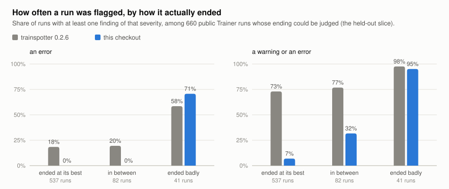

# What 3,145 public training runs look like, and what that did to trainspotter

`transformers.Trainer` writes its whole logging history to `trainer_state.json`
in every checkpoint directory, and many people upload those directories to the
Hugging Face Hub along with the model. That makes thousands of real training
logs public. This study collects them, runs trainspotter over every one, and
compares what it said with how each run actually ended. It then does the two
things a first pass cannot: it scores the reworked detectors on 1,051 logs they
were not tuned on, and it damages runs that ended well by known amounts to see
what the quieter detectors no longer say.

**What came out**

- **The released detectors cried wolf.** trainspotter 0.2.6 raised a warning or
  an error on 75% of the runs that ended at their best loss, and an error on
  21% of them. Of the 615 runs it gave an error, 12% had ended badly. It
  averaged 17 findings per run. "Ended at their best loss" is 1,639 of the
  3,145 logs (52%); the rest were too short, never improved, or ended in between.
- **They were tuned on smooth generated curves.** A logged training loss is one
  mini-batch's average, and its scatter is heavy-tailed. The spike detector
  alone fired on 37% of all runs, 17 times each; the gradient-norm detector on
  40%, 24 times each.
- **After recalibrating on this corpus** the same runs get an error 0% of the
  time and a warning 6% of the time, and 90% of the runs that ended badly get a
  warning or an error. That is a fit to the data they were tuned on. On a second
  collection of 1,051 logs from other accounts, frozen before it was scored, it
  held: of 537 runs that ended at their best, none got an error (95% interval 0
  to 0.7%) and 6.9% got a warning (5.0 to 9.4%), where 0.2.6 gave 18.4% and
  73.0%; 95% of the 41 that ended badly got a warning or an error. The zero is
  largely by design: only `divergence` and `overfitting` can raise an error now,
  and each tests the end-of-run quantity the label is made of.
- **What the quieter detectors no longer say.** 300 held-out runs that ended
  well were damaged by known amounts. A NaN, a late rise that gives back half
  the run's progress, and a mid-run rise of half the progress that lasts are
  each flagged in 99% of cases or more. A short burst is not: one lasting 2% of
  the run goes unreported 59% of the time even at four times the run's
  progress. 0.2.6 flagged every such burst, and 71% of the same runs with
  nothing done to them.
- **About public fine-tuning itself:** of the runs with at least three
  evaluations, one in five ended at least 5% above its best evaluation loss, and
  one in twenty at least 50% above. One in six of the runs that log a learning
  rate used no warmup.

<picture>
  <source media="(prefers-color-scheme: dark)" srcset="figures/alarms-heldout-dark.svg">
  
</picture>

The chart is the held-out slice. The same chart for the first 3,145 logs, on which
the detectors were tuned, is [`figures/alarms-light.svg`](figures/alarms-light.svg).

## The logs

`collect.py` walks the Hub's model listing from the newest model backwards and
keeps every repository that contains a file named `trainer_state.json`, taking
the one from its last checkpoint. At most three repositories are kept per
account, so one prolific uploader cannot become the census. Only that one JSON
file is downloaded, at the commit the listing reported;
[`manifest.json`](manifest.json) records every file read. Seven further
repositories were found and not kept: five whose file is over 30 MB, so the
very longest logs are missing, and two that answered HTTP 401.

The first collection is what the detectors were reworked on. The second
(`manifest-heldout.json`) was collected afterwards by continuing the same
listing from where the first stopped, a rule fixed before any of it was read,
skipping every account that appears in the first. Its repositories were created
4 to 29 July 2026; the first collection's, 29 July to 8 October.

| | First collection | Held-out slice |
|---|---:|---:|
| Models looked at | 220,000 | 73,000 |
| Repositories kept | 3,208 | 1,051 |
| Files of that name written by some other program | 63 | 19 |
| **`Trainer` logs analysed** | **3,145** | **1,032** |
| with a training loss | 3,038 | 1,013 |
| with an evaluation loss | 1,521 | 513 |
| with a gradient norm | 2,977 | 977 |
| adapters (PEFT) | 29% | 30% |
| median training-loss points | 120 | 96 |

In the first collection the Hub's task tag is missing for 1,762 of them; of the
rest, 885 are text generation, 105 image-text-to-text, 89 robotics, 67 text
classification and 55 speech recognition. A quarter logged 31 or fewer points,
and one in twenty more than 6,100. The 3,208 logs come from 1,986 accounts and
the 1,051 from 725; repositories of one account often share a recipe, and some
families of near-identical names (eighteen "OpenThinker" repositories, ten
named "test") remain.

## How a run ended

To judge the detectors there has to be something to judge them against, and it
cannot be another detector. `census.py` describes each run's ending from its
loss values alone:

- its **start** (the median of its first three points or of its first 5%,
  whichever is higher), its **best** level (the lowest rolling median) and its
  **final** level (the median of its last 5% of points). The **progress** is
  start minus best;
- the share of that progress **given back** at the end, (final − best) / progress;
- the **evaluation rise**, how far the last evaluation loss is above the lowest.

| Ending | Rule | First | Held-out |
|---|---|---:|---:|
| good | gave back at most 10% of its progress, and its last evaluation loss is within 5% of its best | 1,639 | 537 |
| in between | neither | 220 | 82 |
| bad | gave back at least half its progress, ended at least half again above where it started, ended 25% or more above its best evaluation loss, or logged a non-finite training loss | 129 | 41 |
| no clear progress | the level never fell clearly below where it started: a flat or reward-driven "loss" | 332 | 91 |
| too short | fewer than 30 logged points | 825 | 281 |

In the first collection the 129 bad endings are 32 that gave back half their
progress, 16 that ended half again above their start, 80 whose evaluation loss
ended 25% above its best, and 1 non-finite. "Ended" means the end of the
`trainer_state.json` of the last checkpoint that was uploaded, which is not
always the end of training.

Two facts about public fine-tuning fall out of those descriptions before any
detector is involved. Of the 1,213 runs with at least three evaluations, 22%
ended 5% or more above their best evaluation loss, 17% ended 10% or more above
it, 10% ended 25% or more above it and 5% ended 50% or more above it (the
held-out slice: 408 runs, 25%, 19%, 10%, 7%). Of the 1,971 runs whose training
loss clearly fell, 8% ended having given back a tenth of that fall and 2.8% a
quarter (held-out: 654 runs, 8% and 3%).

## What each version said

Every log went through trainspotter 0.2.6 from PyPI and through this checkout.
Each used its own log reader: the checkout's differs from 0.2.6's (in how it
treats repeated copies of one step, among other things), so a small part of the
difference is the reader and not the detectors. The first columns are the
runs the detectors were reworked on, so the checkout's numbers there are a fit.
The last two are the held-out slice, scored once with the detectors as they
were committed, and are the ones to believe.

| | 0.2.6 | checkout, tuned on these | 0.2.6 | checkout, held out |
|---|---:|---:|---:|---:|
| **Runs that ended at their best** | 1,639 | | 537 | |
| given an error | 20.6% | 0.0% | 18.4% | 0.0% |
| given a warning or an error | 74.6% | 5.7% | 73.0% | 6.9% |
| **Runs in between** | 220 | | 82 | |
| given an error | 15.9% | 0.0% | 19.5% | 0.0% |
| given a warning or an error | 75.0% | 25.0% | 76.8% | 31.7% |
| **Runs that ended badly** | 129 | | 41 | |
| given an error | 58.1% | 66.7% | 58.5% | 70.7% |
| given a warning or an error | 96.1% | 89.9% | 97.6% | 95.1% |
| **All runs** | 3,145 | | 1,032 | |
| findings per run | 16.7 | 0.9 | 13.4 | 0.9 |
| runs given an error | 615 | 119 | 196 | 41 |
| of those, runs that ended badly | 12.2% | 72.3% | 12.2% | 70.7% |
| of those, runs that ended at their best | 54.8% | 0.0% | 50.5% | 0.0% |

With 95% Wilson intervals, the held-out "ended at their best" rates are 0.0%
(0 to 0.7) and 6.9% (5.0 to 9.4) for the checkout, and 18.4% (15.4 to 21.9) and
73.0% (69.1 to 76.6) for 0.2.6; "ended badly" with a warning or an error is
95.1% (83.9 to 98.7). Those 41 are few.

In 0.2.6 a warning carried almost no information: it was raised on 75% of the
runs that went well and on 96% of the runs that went badly. Of the checkout's
119 errors in the first collection, the 28% that are not on a bad ending are all
on runs the labels do not cover: too short, or with no clear progress.

**Why the zero is not much of a result.** In the checkout `spikes` is never an
error and `setbacks` is at most a warning. An error can come only from
`divergence` (at least half the run's progress given back at the end, or a
non-finite training loss) and `overfitting` (a last evaluation loss 50% above
the best). The bad label is built from the same end-of-run quantities (give-back
of half the progress, an evaluation loss 25% above its best), and "good" requires
a give-back of at most a tenth. So an error on a run that ended well is nearly
impossible whatever the data. What the held-out slice does test is the
warning level, and that the thresholds did not just memorise 3,145 runs.

## What it no longer catches

Being quiet on runs that ended well is half of a detector. The other half is
what it misses, and the endings cannot measure that: a run that went wrong in
the middle and recovered is labelled "good". So `inject.py` takes held-out runs
that ended well and damages a copy of each by a known amount, in units of the
run's own progress P (its starting level minus its best), by rules fixed
without looking at what any detector says. 300 runs with 30 to 3,000 logged
points; 118 of them have at least three evaluations.

The share of damaged runs that get a warning or an error, among the runs that
got neither before the damage (279 of 300 for this checkout, 86 of 300 for
0.2.6, which had already flagged the rest):

| Damage | 0.2.6 | This checkout |
|---|---:|---:|
| One logged loss is NaN | 100% | 100% |
| The last tenth climbs by 0.25 P | 69% | 60% |
| by 0.5 P | 86% | 99% |
| by P | 97% | 100% |
| A rise of 0.25 P from 40% to 55% of the run, then back | 38% | 40% |
| of 0.5 P | 55% | 99% |
| of P or more | 69% to 99% | 100% |
| A burst over 2% of the run, 0.5 P high | 69% | 9% |
| P high | 80% | 37% |
| 2 P high | 97% | 41% |
| 4 P high | 100% | 41% |
| One point 0.5 P high | 65% | 20% |
| P high | 80% | 79% |
| 2 P high | 94% | 90% |
| 4 P high | 100% | 94% |
| The last evaluation loss 10% above the best | 23% | 11% |
| 25% above, in one jump | 41% | 20% |
| 25% above, reached by a climb | 56% | 93% |
| 50% above or more | 62% to 69% | 93% to 95% |

The checkout sees what lasts and what is large: sustained rises, late
divergence, big single points, an evaluation loss that climbs. It is weaker
than 0.2.6 in two places. A burst of a few logged values is too wide for
`spikes`, which scores single points, and too short for `setbacks`, which wants
a stretch; three bursts in five go unreported at any height. And a last
evaluation a quarter above the best is reported one time in five when it
arrives in one jump, since one point is not a trend. Small things (a rise of a
quarter of the progress, a point half the progress high) are left alone by
design, and the table shows that cost too.

0.2.6's column needs reading with its other number: it warned on 71% of these
same 300 runs before anything was done to them, against 7% for the checkout.

On real runs, with no damage added: among the 537 held-out runs that ended
well, 7 have a stretch where the smoothed loss rose at least half the run's
progress above its earlier best and recovered. The checkout flags all 7, and
0.2.6 flagged 6. In the first collection it is 28 of 29 against 24, and the
one the checkout is silent on is silent at every height.

The detectors were not changed after these measurements.


## What changed in the detectors

Each change answers something visible in these logs. The detectors' docstrings
carry the full algorithms. The numbers in the middle column are on the first
collection.

| Detector | 0.2.6 on this corpus | Now |
|---|---|---|
| `spikes` | Any point more than 6 MADs from a 21-point trailing median: 37% of runs, 20,261 findings, 575 runs given an error. Two thirds of the runs it flagged ended at their best loss. | A point must also be large next to what the run achieved: half the run's progress for a warning, a tenth for a note. Scored on the log of the loss, against the run-wide scatter. 3.8% of runs. |
| `setbacks` | (did not exist) A public run whose level rose from 0.51 to 1.43 and stayed up for 13,000 of its 39,000 steps got four spike findings and nothing about the rise. | New. A stretch where the smoothed loss sits a quarter of the run's progress above a level it had already reached, reported with the steps it cost. 2.0% of runs. |
| `divergence` | The last point at 1.5 times the lowest point, with a rising tail, on training or evaluation loss. Of the 57 runs it flagged this way, 26 were on the evaluation loss, where a rise beside a training loss near its best is overfitting. | The log ends inside a rise and a quarter (warning) or half (error) of the run's progress is gone; or the loss only ever rose. A NaN in an evaluation metric is a warning. 2.4% of runs. |
| `overfitting` | A warning from a 1% rise. | Severity follows the size of the rise: a note below 10%, a warning from 10%, an error from 50%. Runs with three or four evaluations, which no slope test can pass, are reported when the last one is far above the best. |
| `grad_norm` | A warning for every reading 10 MADs out: 40% of runs, 30,098 findings. Two thirds of those runs ended at their best loss. | One note per run that counts the readings at least ten times the rolling median. |
| `lr_schedule` | A warning for no warmup (one run in six of those that log a learning rate; it is `Trainer`'s default), and a "discontinuity" for each step of a warmup logged every few steps. | Both are notes, and a rise before the learning rate has ever fallen is warmup. |
| `eval_noise` | A warning. | A note: it is advice about choosing a checkpoint. |

Three things that are not detectors also came out of reading real logs. Every
log with an evaluation printed a block of "repeated reading" lines, because
`Trainer` writes `epoch` into both the training entry and the evaluation entry
of a step. The HTML report drew a chart for each of `eval/runtime`,
`eval/samples_per_second` and `eval/steps_per_second`, flat lines in nearly
every log, and one log carries 190 metrics. And a "loss" that goes negative is
some other objective, not a suspiciously low loss.

## A real run

The report below is this checkout's, on one of the collected logs (a public
fine-tuning run; the file is not redistributed here). 0.2.6 gave it one error and
three warnings, all for single points.


## What this does not show

- **Out of sample is not out of population.** The held-out slice is the same
  Hub, earlier weeks, other accounts, collected the same way. It shows the
  thresholds were not memorised; it does not show how the detectors do on
  training runs that are not public `Trainer` uploads. The detectors' docstrings
  were edited after it was scored, to correct the counts they quote; no
  behaviour changed.
- **The endings are computed from the same numbers the detectors read.** For
  `divergence` and `overfitting` the label and the detector are nearly the same
  calculation, so "errors land on bad endings" is true there by construction,
  and so is "no errors on runs that ended well". What the labels test
  independently is everything else: whether a spike, a gradient-norm or a
  learning-rate finding says anything about how a run goes, and it mostly did not.
- **A run that went wrong in the middle and recovered is "good".** The labels
  cannot see it. The only measure of that is the injected-fault table, and it is
  synthetic: real logs, damaged by shifting values, not real failures.
- **A bad ending is not a bad model.** A run with `load_best_model_at_end` that
  overfits afterwards ships its best checkpoint. The label describes the log.
- **Nobody labelled these runs by hand.** Thresholds were chosen by looking at
  plots of a few dozen flagged runs at a time, and are not the result of a
  search. A different reasonable choice would move the numbers by a few points.
- **This is not a sample of all training, nor of all of the Hub.** It is ten
  weeks of public uploads that included a checkpoint directory (and three and a
  half more in the held-out slice): mostly small fine-tunes, a third of them
  adapters, at most three per account, newest first, without the eight logs over
  30 MB.
- **825 runs are too short to label,** and 332 never clearly improved. The
  detectors still run on them; the table's "all runs" rows include them.

## Reproduce

```sh
git clone https://github.com/antonsoo/trainspotter && cd trainspotter
uv sync
uv run python studies/hub-census/collect.py          # downloads manifest.json's 3,208 files into cache/ (1.2 GB)
uv run python studies/hub-census/collect.py --manifest studies/hub-census/manifest-heldout.json
                                                     # the held-out slice's 1,051 files (0.2 GB)
for prefix in "" "--manifest studies/hub-census/manifest-heldout.json --prefix heldout-"; do
  uv run python studies/hub-census/census.py --endings-only $prefix
  uv run python studies/hub-census/census.py --label current $prefix
  uv run --no-project --with trainspotter==0.2.6 --with numpy \
      python studies/hub-census/census.py --label 0.2.6 $prefix
done
uv run python studies/hub-census/inject.py --label current
uv run --no-project --with trainspotter==0.2.6 --with numpy \
    python studies/hub-census/inject.py --label 0.2.6
uv run python studies/hub-census/probe.py
uv run python studies/hub-census/claims.py
uv run --no-project --with trainspotter==0.2.6 --with numpy \
    python studies/hub-census/claims.py --divergence
uv run python studies/hub-census/report.py           # results.json and figures/
```

Each census pass takes about a quarter of an hour on one core, `inject.py` an
hour or more (it runs the detectors on twenty damaged copies of 300 logs), and
`probe.py` about ten minutes. `collect.py` downloads the files the manifest
lists, each at its recorded commit; repositories deleted or made private since
are skipped and counted. `collect.py --rescan --models 220000` walks the Hub's
listing again instead and writes a new manifest, which will hold newer models
than this one. The held-out manifest was made with
`collect.py --rescan --continue-after studies/hub-census/manifest.json --manifest studies/hub-census/manifest-heldout.json --models 600000 --logs 1050`,
which needs the first collection's `cache/scan-state.json`, the listing cursor it
ended on: the models whose Hub id sorts below `6a69cfd24555e0bc18e8cb4e`.
