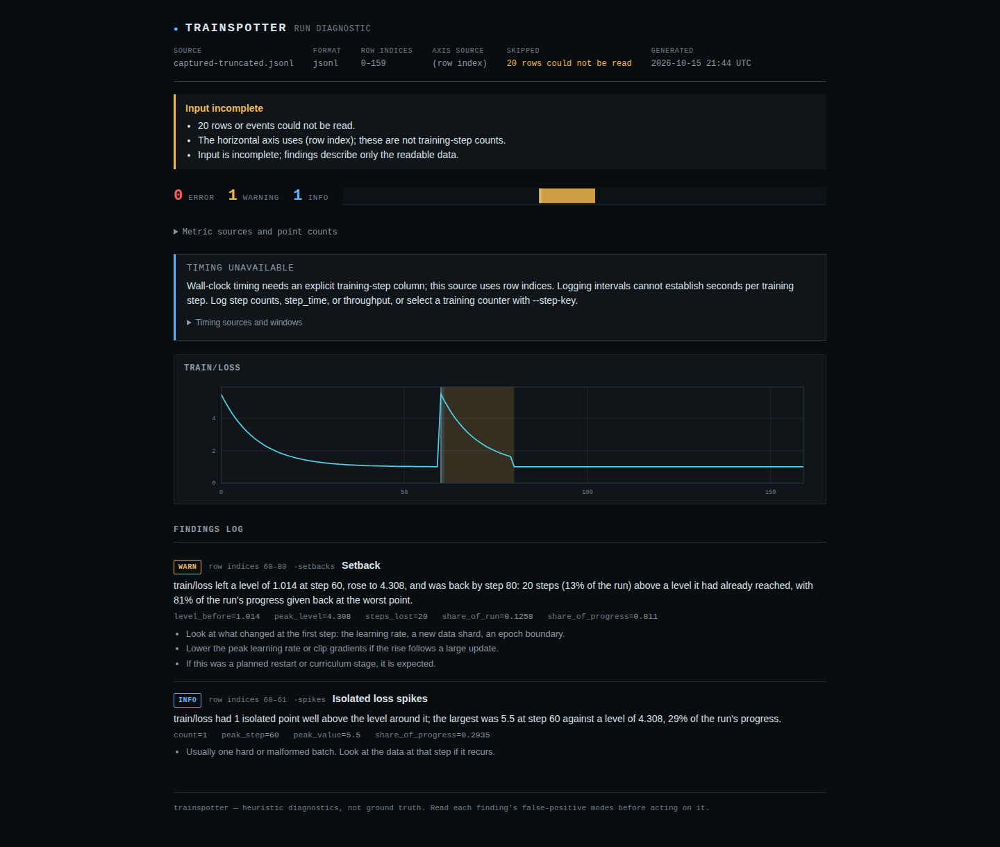
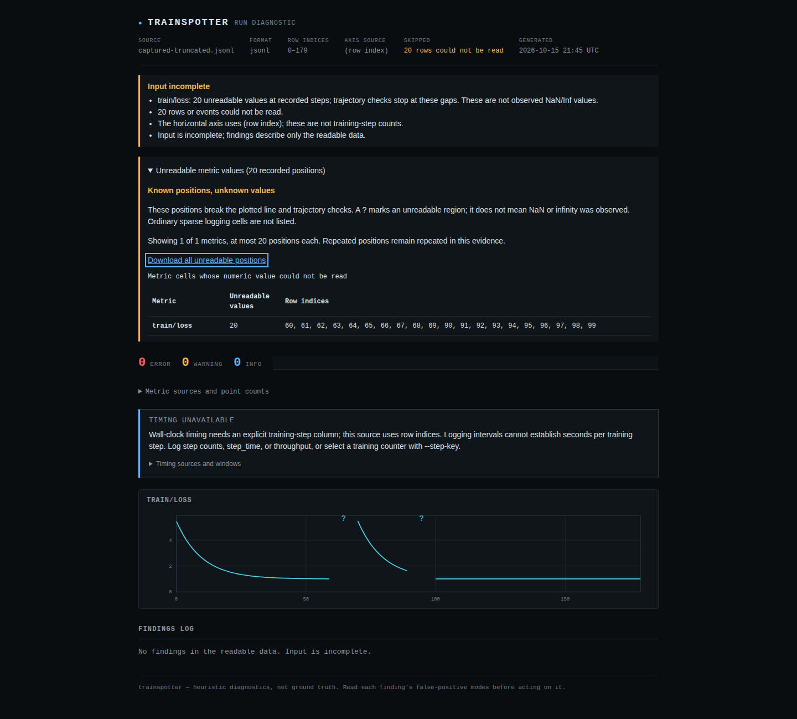
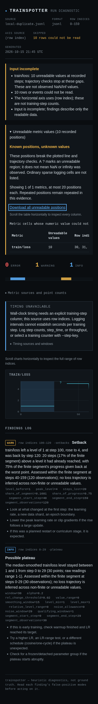

# Rejected JSONL records keep their source positions

Baseline `279e7c0098de0b040344aea8d4055201c41cb7fd` discarded rejected JSONL
records before enumerating the remaining objects. In a file without a step
column, that renumbered later observations and connected loss trajectories across
known data loss. A flat/gap/flat control became **Diverged (rose from the start)**,
with advice to lower the learning rate.

```text
Nonblank source record:  0 ........ 49 | 50 .... 59 | 60 ........ 109
Input:                  loss = 1     | unreadable | loss = 3
Old ordinal coordinates: 0 ........ 49 | discarded  | 50 ......... 99
Correct coordinates:     0 ........ 49 | unknown    | 60 ........ 109
Trajectory:             first segment | boundary   | second segment
```

The repair keeps each rejected record's position when the entire accepted source
has no step column. Existing unreadable-value handling then breaks the plotted
line and trajectory checks. It neither invents numeric readings nor calls an
unreadable position an observed NaN. Explicit step axes still cannot locate a
wholly undecodable record; they never borrow its ordinal position.

## Reproduced diagnoses

[`replay.py`](replay.py) runs the actual JSON and standalone HTML CLI for 24
cases. Four controlled faults replace selected records: truncated JSON, repeated
keys, an array and a top-level `null`. These are rejected metric-log records;
an array or `null` can be valid JSON without being a supported metric object.

| Result | Baseline | Repaired source |
|---|---:|---:|
| Cross-gap diagnoses in 16 controlled cases | 20 | 0 |
| Valid later setbacks in four local-event cases | 0 | 4 |
| Rejected-record cases returning incomplete-input exit 2 | 20/20 | 20/20 |
| Actual NaN readings reported in the NaN control | 20 | 20 |

The four capture-derived cases start with the retained
[controlled CPU PyTorch experiment](../finite-segments/README.md): 180 loss
observations, including 20 deliberately empty logging reductions. This study
verifies its retained SHA-256, projects its loss column to counter-free JSONL,
then substitutes one controlled fault at each of those 20 positions. Other loss
values keep their order and value. This is an **authored format conversion and
fault injection**, not a native JSONL training capture or a prevalence estimate.
The old report asserted a setback at row indices 60-80 and isolated spikes at
60-61; both disappear once the missing positions remain visible.

The remaining patterns are explicitly synthetic rise, spike, setback and
later-event controls. The later intact segment still yields its setback at
indices 100-120. A fully readable finite control retains its setback at 60-80.
The NaN control keeps its actual observations and error-gate exit 1.

Input completeness was already false for rejected records before this repair.
This fixes unsupported diagnoses and lost coordinates, not a previously passing
input-integrity gate. Timing remains unavailable on a row-index axis: record
positions do not establish training progress.





## Checks and boundaries

- [Before](results/before.json) and [after](results/after.json) retain every input
  hash, complete JSON report, CLI exit and generated HTML hash. Four additional
  controls cover finite readings, actual NaNs, sparse objects and explicit steps.
- [All 68 pre-existing CSV/JSONL inputs](results/controls-before.json) retain
  identical complete report hashes or explicit reader rejections
  [after correction](results/controls-after.json). These are 66 CSVs and two
  JSONLs, including native exports and authored adverse fixtures; they are not
  68 independent training runs or a counter-free JSONL corpus.
- [Live ordinary-pipe watch](results/watch-source.json) observes the gaps while
  the process stays alive, then delivers the newly supported rise after file
  correction. A second process watches a writer finish its last object by
  appending bytes alone: the unknown position becomes the reading at index 1.
  No pseudo-terminal or unbuffering override is used.
- [Python 3.10.21 / NumPy 1.24.0](results/wheel-minimum.json) and
  [Python 3.14.7 / NumPy 2.5.4](results/wheel-current.json) isolated core-wheel
  installations produce all 24 complete JSON reports identically to the repaired
  source. Neither installation includes TensorBoard. All
  [68 compatibility controls](results/controls-wheel-minimum.json) also match
  under the oldest allowed NumPy, and the
  [installed live watch](results/watch-minimum.json) completes both scenarios.
  The installed console entry points independently return exit 2 for the
  incomplete rise control, with its ten unreadable positions and no divergence.
- [Artifact byte comparison](results/artifacts.json), reproduced by
  [`artifacts.py`](artifacts.py), matches all 29 runtime files, including
  `py.typed`, in source, sdist, wheel and both installations. A fresh archive at
  `9eece1f56f198dd18d0433d1e2c3271e2fec2f89` installs locked development and
  optional dependencies, passes lint, mypy and all **749 tests**, and builds the
  sdist and wheel. The 16 new source-position tests are included in that count.
  The same clean archive also passes the full **216 report workflows** in
  Chromium and Firefox at desktop and 320px mobile, including the permanent
  JSONL gap fixture, keyboard interaction, downloads, axe and CSP checks.
  [Clean-check receipt](results/clean-checks.json).
- [Offline browser before](results/browser-before.json) and
  [after](results/browser-after.json) cover eight local-file workflows each:
  two reports in Chromium and Firefox at 1440px and 375px. Each fresh context is
  offline before opening the report. The repaired capture has three plotted
  segments; the later-event report has two. Keyboard downloads contain the exact
  unknown coordinates. No external requests, page errors, CSP violations,
  horizontal page overflow or axe violations were observed. All three retained
  screenshots were inspected. Wide evidence tables and charts scroll internally.



Blank physical lines remain ignored, so these are zero-based **nonblank record
indices**, not physical line numbers. Valid sparse objects (`{}` or
`{"loss":null}`) do not become unreadable boundaries. A top-level `null` record
is different from a null metric cell inside an object. Text-only columns remain
metadata; custom numeric metrics retain boundaries too, including before their
first numeric reading. Rejected values and clocks are never trusted. Row
rejections do not additionally increment the invalid-scalar count.

The [source-position regressions](../../tests/test_jsonl_record_gaps.py) also
cover leading/trailing rejections, scalar/array records, duplicate keys, deep
JSON rejection, late metric discovery, explicit custom steps, sparse cells,
BOM/CRLF/blank lines and partial-record completion.

[`scaling.py`](scaling.py) measures 1,000, 10,000 and 100,000 counter-free records
with 10% rejected records. Three samples per version and size run on a shared
14-logical-CPU WSL2 Linux host with 47.05 GiB RAM, without CPU affinity. The
100,000-record medians are 0.814s [before](results/scaling-before.json) and 0.919s
[after](results/scaling-after.json), with 10,000 additional unknown positions
retained. These observations describe loading cost, not an isolated benchmark
or a promised speedup.

## Replay

From the repository root, with dependencies installed:

```sh
uv run python studies/jsonl-record-gaps/replay.py --source . --verify \
  --out /tmp/jsonl-replay.json --artifacts /tmp/jsonl-reports
uv run python studies/jsonl-record-gaps/watch.py --source . \
  --out /tmp/jsonl-watch.json --artifacts /tmp/jsonl-watch
node studies/jsonl-record-gaps/browser.mjs /tmp/jsonl-reports \
  /tmp/jsonl-browser.json verify /tmp/jsonl-screenshots /tmp/jsonl-replay.json
```

Use `--source /path/to/baseline` without `--verify` for the baseline replay.
For an installed wheel, omit `--source` and supply `--python /path/to/venv/bin/python`.
Each subprocess removes inherited `PYTHONPATH`; its working directory is outside
the checkout. Browser dependencies come from `npm ci`, using installed browsers.

These are source and local-artifact checks. No PyPI release, tag or manual
hosted-demo deployment was performed.

[Public source receipt](results/public-source.json): all 33 changed files at
`f938cce0859d8753008ed1068d6f7465c55892eb` matched the clean checkout and pinned
GitHub raw-file bytes; remote main matched that revision at verification.
