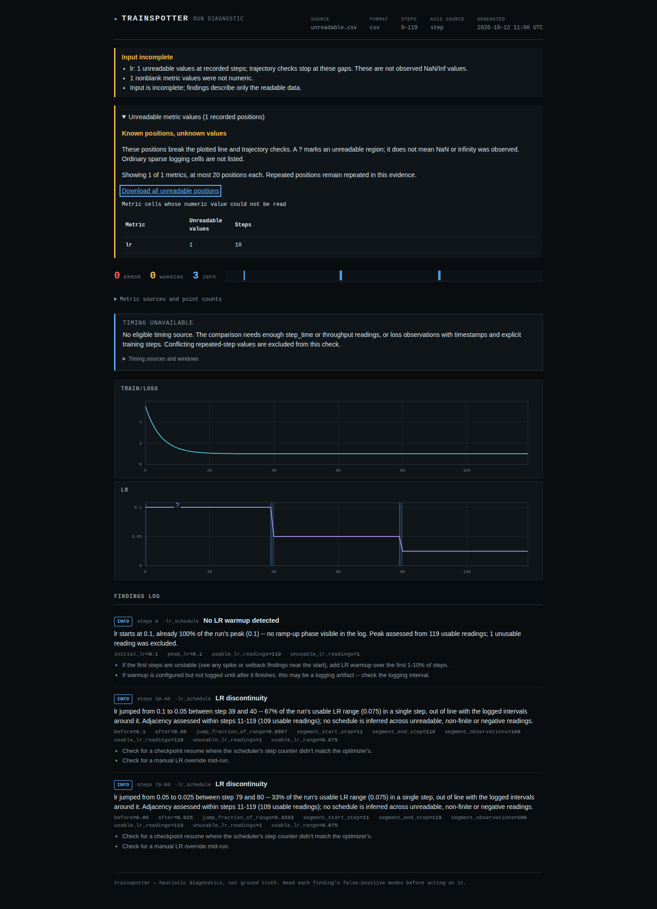

# Keep supported LR changes visible around unusable readings

In baseline `44c5379f404d7016eb3ae49ef4d2e99fa0748429`, one unreadable or
NaN/Inf learning-rate reading can suppress every discontinuity finding in
the run. A finite negative reading can instead create a spurious jump and
inflate the range enough to hide real changes. The rebound check already
stopped at these observations; the peak/range and discontinuity checks did not.

## Controlled optimizer capture

[`capture.py`](capture.py) runs 120 real scalar SGD updates in PyTorch 2.8.0+cpu.
The objective is `1 + w**2/2`, starting from `w=3` and learning rate 0.1.
`MultiStepLR` halves the rate at scheduler steps 40 and 80, after optimizer
updates. These are **intended schedule changes**, not faults inferred from
their presence. The experiment needs no external model, data or GPU.

[`optimizer.csv`](captured/optimizer.csv) records the actual loss, weight and
configured rate before each update. Five deliberately damaged exports change
only the LR cell at step 10 to `LOGGER_ERROR`, `nan`, `inf`, `-inf`, or `-1`.
Their loss readings and the optimizer state remain identical. This is a
controlled export-fault experiment, not a production log.

| Logged history | Baseline discontinuity notes | Fixed behavior |
| --- | --- | --- |
| Complete optimizer capture | Steps 39-40 and 79-80 | Same notes |
| One unreadable, NaN, or infinite LR cell at step 10 | None | Keep steps 39-40 and 79-80 |
| One negative LR cell at step 10 | Spurious steps 9-10; both real drops hidden | Keep only steps 39-40 and 79-80 |
| Level change across an unreadable reading | None | Still no invented adjacent jump |
| Decline, gap, then an initial rise | Entire check suppressed | Keep the observed decline; do not infer a restart through the gap |
| Five usable readings after a gap | None | Too little contiguous context for a discontinuity note |

The last three histories are explicitly synthetic boundary controls. Findings
remain informational: logs do not establish whether a scheduler was configured
correctly. An unreadable cell still makes the input incomplete and returns
exit 2. NaN/Inf and negative LR cells remain recorded observations; this change
does not add an optimizer-failure diagnosis or change their CLI exit policy.

## Evidence rule

Peak and range calculations use finite, nonnegative LR observations. The
discontinuity threshold remains 20% of the **whole run's usable range**, so a
small-range segment cannot inflate its own changes into large jumps.
Neighboring rates, phase detection and the minimum six observations belong
to one contiguous usable segment. An initial rise after a gap does not inherit
a falling phase from before the gap. The existing rebound check and its
deduplication of upward jumps remain in place.

Missing-warmup notes require the original first reading to be usable and at
least 20 usable readings by default. A later first usable point cannot stand
in for a damaged beginning. Gapped-history findings retain usable/unusable
counts; discontinuity evidence also names segment endpoints and range. No
values are interpolated, dropped from the input report, or used to join gaps.

## Independent checks and reproduction

[`replay.py`](replay.py) checks every captured weight and objective with
70-digit Decimal arithmetic, independent of PyTorch and the detector:

```text
w(n) = 3 * .9^min(n,40)
         * .95^min(max(n-40,0),40)
         * .975^max(n-80,0)
loss(n) = 1 + w(n)^2/2
```

It verifies capture hashes and that only the declared cell differs in each
faulted export, then invokes the actual CLI for JSON and standalone HTML.
`browser.mjs` opens those HTML files offline in Chromium and Firefox at 1440px
and 375px, compares displayed findings with JSON and downloads the recorded
unreadable LR coordinate using the keyboard.

```sh
uv run --locked python studies/lr-gaps/replay.py --expect after --out /tmp/lr-after.json --artifacts /tmp/lr-after
node studies/lr-gaps/browser.mjs /tmp/lr-after /tmp/lr-after.json /tmp/lr-browser.json /tmp/lr-images
uv run --locked python studies/scheduler-rebounds/audit.py --baseline-ref 44c5379 --out /tmp/lr-corpus.json
```

Use `--python /path/to/installed/venv/bin/python` to replay an installed wheel.
For the baseline, extract the pinned source and pass `--source /path/to/src
--expect before`. The corpus command needs the pre-existing public-log cache;
it does not download or fabricate missing runs.

The available corpus replay reads 3,145 calibration logs and 1,032 held-out logs.
Of these, 4,052 have usable LR series totaling 5,048,345 observations. All 872
findings are unchanged, including their messages and evidence. Eighty-two
listed source files remain unavailable and are reported separately. This is
compatibility evidence on the available historical cache, not a fresh accuracy
estimate or proof about future logs.

Sources: [PyTorch MultiStepLR](https://docs.pytorch.org/docs/2.8/generated/torch.optim.lr_scheduler.MultiStepLR.html)
and [NumPy's NaN-propagating maximum](https://numpy.org/doc/2.0/reference/generated/numpy.max.html).
PyTorch is a capture-only dependency, not a new Trainspotter dependency.

## Retained results

- [Baseline CLI reports](results/before.json), [minimum-dependency installed reports](results/minimum.json),
  and [Python 3.14 installed reports](results/installed314.json).
- [Public-log comparison](results/corpus.json), including unavailable inputs.
- [Baseline offline browser checks](results/browser-before.json) and
  [installed offline browser checks](results/browser-installed.json).
- Standalone unreadable-LR report [before](reports/before/unreadable.html) and
  [after](reports/after/unreadable.html); download either file to open it offline.
- [Clean archive, installed artifact and runtime verification](../../docs/verification-lr-gaps-2026-10-12.md).


