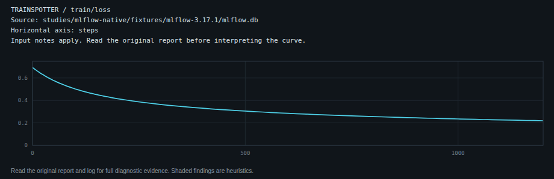
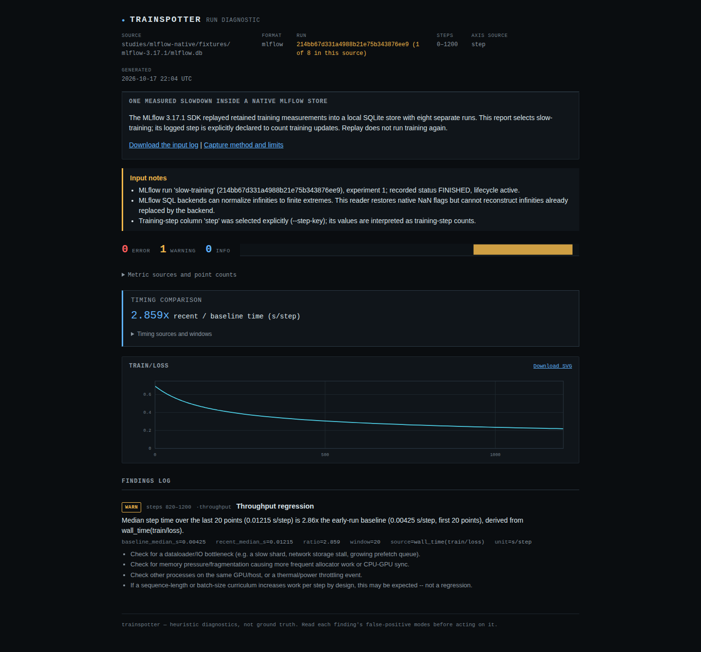

# Source and installed-artifact verification

The archived checkout at `a309f032288e00d086c399f00323642126a2e57f` passed:

- Python 3.12.12: locked fresh install, ruff, mypy on 32 source files, all 793
  tests, sdist/wheel build and the 18-report static site build.
- Python 3.10.21: the archive-built wheel, all 793 tests, numpy 1.24.0,
  TensorBoard 2.12.0 and PyYAML 6.0.3 (the lowest direct dependency resolution).
- The existing browser matrix on both the working source and fresh archive: 220 report workflows in
  Chromium/Firefox, desktop/320px, including keyboard access, axe, CSP and no
  network. The archived run used Node 24.21.0 after `npm ci`.

The [wheel receipt](package-verification.json) records its hash and all 32
installed modules matching the source bytes. The base installation contains
only Trainspotter and numpy; it reads SQLite without MLflow or PyYAML present.
Adding the `mlflow-files` extra installs PyYAML, then the [installed replay](installed/after.json)
compares every native observation again and runs the CLI gates. The separate
SDK writer also passes the [installed live workflows](installed/live.json),
including pinned selection, newly logged NaN and explicit deleted-run reads.

The wheel is an **unreleased local artifact** with the repository's existing
0.2.6 metadata. It is not the published PyPI 0.2.6 artifact. No registry release,
version bump or tag was made.

The [local browser receipt](installed/browser.json) opens the archive-built
sample directly from disk, disconnects, downloads its native database, checks
the exact input hash and re-runs the installed CLI. It downloads the SVG by
keyboard and opens that saved chart independently. All four contexts
(Chromium/Firefox, 1440/375px) pass without page errors, horizontal overflow,
accessibility violations or HTTP requests. Screenshots were visually reviewed.

The retained W&B clock has been quantized to native MLflow milliseconds. Its
reported ratio is therefore the comparison from that native history; it is
not a new timing run or a promise to reproduce unrounded clock arithmetic.
All [17 existing sample reports](source/report-controls.json) remain identical
after normalizing only the single generated-time field in each HTML document.

## Public sample

Source `fa02975` and Pages deployment `1021f17` publish the same reader behavior
and clarify which gallery inputs are native replays. All 19 generated HTML
files, plus the canonical root alias, match the deployed build's exact bytes:
[HTTP receipt](hosted-bytes.json), [publication boundary](publication.json).
The [public browser replay](hosted/browser.json) follows the gallery card, waits
for the complete report to load, disconnects, downloads its original SQLite
database and replays that download with the independently installed wheel.
It also saves and reopens the SVG. Chromium/Firefox at 1440/375px pass with no
page errors, accessibility violations, horizontal overflow or extra HTTP
requests after loading. Downloaded vectors are byte-identical to the local
ones; all four standalone screenshots match their reviewed local images.

This establishes the source, local wheel and public static report. PyPI's
0.2.6 wheel was downloaded and inspected separately: it has neither the native
MLflow reader nor the `mlflow-files` extra. No registry release or tag was made.
The separately hosted Hugging Face workbench was not redeployed or verified
for this capability.
