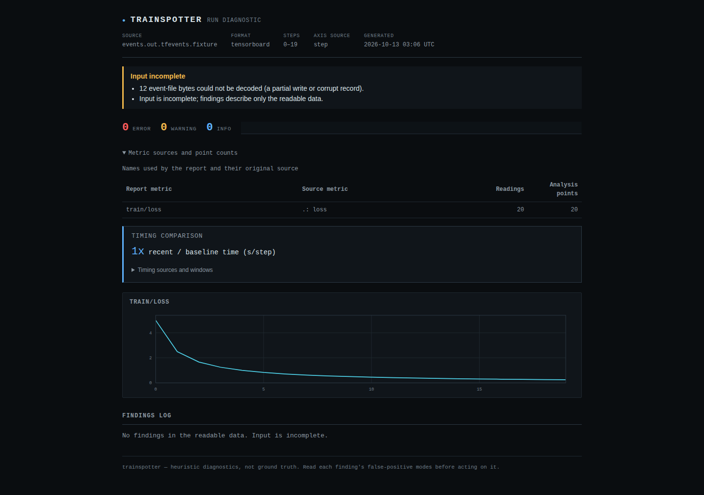

# Keep a damaged length header from losing the readable run

A 938-byte TensorBoard file could make the reader attempt an allocation of
`2^60` bytes and raise `MemoryError`. Its 20 preceding scalar readings never
reached the report. The previous guard caught an even larger length's
`OverflowError`, but did not prevent the allocation attempt for this case.

The correction checks whether each advertised record fits the local file
before asking TensorBoard to decode it. The readable prefix is retained,
the 12-byte tail is reported as unread, and `--fail-on error` exits **2** for
incomplete input. JSON, HTML and one-shot watch all retain the result.



## Input and reproduction

`prefix.tfevents.fixture` is a **controlled synthetic capture**, written by
TensorBoard 2.21.0's `EventFileWriter`: 20 scalar `loss` readings, steps 0-19,
values `5 / (step + 1)` stored as float32, and wall times 100-119. It contains
926 bytes, including the writer's real initial metadata record. No training
job or production incident is claimed.

The replay appends deliberately damaged tails to disposable copies. The
length headers have valid checksums so they reach the old decoder's attempted
read. Each child process has a **512 MiB address-space limit** on POSIX; the
limit does not apply to the parent or host. TensorBoard's unsampled
`EventAccumulator` independently supplies the expected prefix observations.

From a checkout with the `tensorboard` extra installed:

```sh
python studies/record-lengths/replay.py /tmp/trainspotter-records-after after
```

Choose a new output directory. To replay the old reader, use a separate
checkout of `ab7831d43f41c7bb1aa1eeb6f7f59d6b84e48737` and set `PYTHONPATH`
to that checkout's `src` while running this script with `before`.
The [before](before.json) and [after](after.json) records retain input hashes,
process exits, recovered counts and agreement with the independent reader.

| Case | Previous result | Corrected result |
|---|---|---|
| Complete prefix | 20 readings, exit 0 | Unchanged |
| Header advertises `2^60` bytes | `MemoryError`, exit 1, no report | 20 readings, 12 unread bytes, exit 2 |
| Headers advertise 64 MiB, `2^63`, or uint64 maximum | 20 readings, 12 unread bytes, exit 2 | Same result, length checked before decoding |
| Incorrect header or payload checksum | 20 readings, 42 unread bytes, exit 2 | Unchanged |
| Last three bytes of the next record missing | 20 readings, 39 unread bytes, exit 2 | Unchanged |
| Only seven bytes of the next header present | 20 readings, 7 unread bytes, exit 2 | Unchanged |
| Complete the previously partial record and reload | 21 readings, exit 0 | Unchanged |

The damaged-length file also prevented both HTML output and one-shot watch
before the correction. Both now retain the partial report and exit 2.
`browser.mjs` checks that HTML offline in Chromium and Firefox at 1440px and
375px, including the incomplete notice, source counts and keyboard access to
the phone's horizontally scrollable table/chart. Four screenshots were
inspected; the desktop view above is retained.

## What is checked before decoding

The [TFRecord format](https://www.tensorflow.org/tutorials/load_data/tfrecord#tfrecords_format_details)
stores a uint64 length and two CRC32C checksums:

```text
8-byte length -> 4-byte header CRC -> N payload bytes -> 4-byte payload CRC
```

The preflight reads only the length, then requires `N + 16` bytes to fit in
the remaining file. TensorBoard's decoder continues to validate both CRCs;
the preflight does not treat a plausible length as valid event evidence.
Protobuf decoding and scalar/restart handling are unchanged.

Each file's size is captured at the start of its pass. A regression check
appends a complete event while the SDK is reading: that first pass retains
the original reading and reports the newly appended bytes as unread; a
fresh load then recovers both readings. A growing writer cannot indefinitely
extend this pass.

This is **not a memory cap for fully present large records**. It does not
guarantee consistent data during in-place rewriting or replacement of a
file. The retained package checks use TensorBoard's standalone decoder;
they do not claim validation of an installed TensorFlow runtime.

## Cost on a controlled scalar workload

`benchmark.py OLD_SRC NEW_SRC NEW_DIRECTORY` writes 20,000 SDK events with
four scalar values each, warms each reader once, and times three loads in
separate processes using the same interpreter and SDK.
[Captured timings](benchmark.json) retain all observations' digest and the
two reader source hashes.

On this 14-vCPU WSL2 machine, Python 3.12.12 and TensorBoard 2.21.0, the
2,023,574-byte file produced **80,000 identical readings** before and after.
The median time changed from **0.563 s to 0.653 s**. The extra check has a
cost; these three local trials are not a production benchmark or a speed
guarantee.

This correction is source-only. It does not publish a PyPI release or deploy
the hosted examples.
