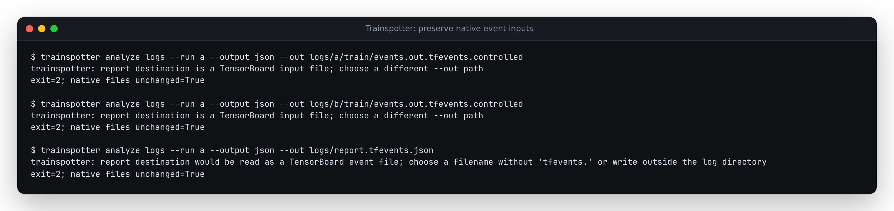

# Keep training observations out of report destinations

Source correction, verified 2026-10-12. No PyPI release or hosted deployment.

The previous guard compared a report destination with the input path. That worked
for a single-file input, but a TensorBoard input path is often a directory.
Writing a report over one of its event files passed the check and destroyed the
native observations.

The [first reproduction](before.json) used TensorBoard 2.21.0's actual
`EventFileWriter`, recording twenty synthetic scalar loss readings. Against
source `b91e658b6cc636d6a31e756e7e4fa9f94aac7c63`, a JSON report destination equal
to the event file exited **0**, replacing **926 bytes of native records** with
**2,075 bytes of JSON**. The retained [native file](events.out.tfevents.controlled)
contains the original SDK bytes; its filename is normalized. No real training
job or private data was used.



## What changes

Directory reading and output protection now share TensorBoard file-discovery
rules. Before replacing a report, the CLI checks every discovered event file,
including files from runs excluded by `--run`. Resolved paths and file identities
cover direct paths, symbolic links, hard links and symlinked parent directories.
It also rejects a new event-like report name inside the source tree: otherwise
the next read could try to decode JSON/HTML as a TFRecord.

| Destination | Before | After |
| --- | --- | --- |
| Selected run's event file | Exit 0; native file replaced | Exit 2; original bytes retained |
| Unselected run's event file | Exit 0; native file replaced | Exit 2; original bytes retained |
| Existing event through a path alias | Exit 0; destination replaced | Exit 2; alias and original files retained |
| New `logs/report.tfevents.json` | Exit 0; creates invalid future event input | Exit 2; no file created |
| Existing `logs/report.json` or `.html` | Normal report replacement | Normal atomic report replacement |

Replacing an outside hard link or symlink does not itself truncate the original
inode because replacement is atomic. It is still refused as an input alias;
the [before replay](before-destinations.json) preserves that distinction in its
separate native-file and destination checks.

[The after replay](after.json) exercises seven destination forms in each of
terminal, JSON and HTML modes: 21 actual CLI calls. Both selected and unselected
native files remain byte-identical; destinations and links stay intact, and
temporary report files are absent after refusals. Three ordinary report formats
are then replaced inside a log directory. A new analysis still reports complete
input and all twenty loss readings. Unit coverage also includes symlinked source
directories and the reader's ignored `.profile-empty` placeholders.

## Reproduce safely

Every replay directory must be new. The script copies the retained native file
into disposable selected/unselected writer directories before any write attempt.

```sh
uv sync --locked --all-extras
uv run python studies/report-inputs/replay.py /tmp/trainspotter-output-check --source src
```

The resulting `replay.json`, captured `terminal.txt` and three safe reports remain
in the output directory. To check the old behavior, archive the baseline commit
to a separate directory and pass its `src` as `--source`, with `--expect before`
and a different new output directory. This intentionally replaces **disposable
copies only**. `capture.py NEW_DIRECTORY` can produce a fresh SDK capture with the
same controlled readings; header times and hashes will differ.

`--python /path/to/installed/environment/bin/python` without `--source` exercises
an installed package. The script removes inherited `PYTHONPATH` in that mode and
records Python, TensorBoard and Trainspotter versions.

The guard covers destinations managed by Trainspotter, including `--out` and
default HTML output. Shell redirection opens its target before the program runs
and cannot be protected here. File identities are checked before replacement;
this is not a lock against concurrent filesystem mutations. The source report
format, detector results and supported TensorBoard restart semantics are unchanged.
