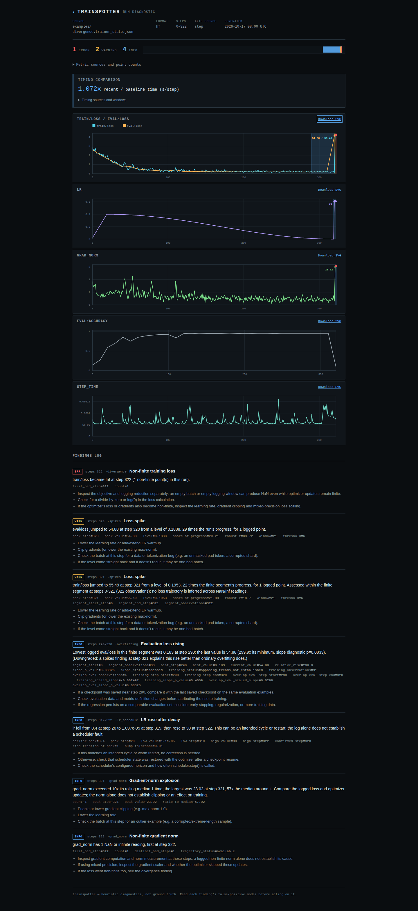
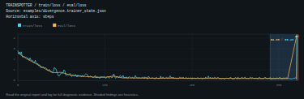

# Standalone vector charts

The HTML report already drew annotated SVG curves. A reader could inspect
those curves, but sharing one meant taking a screenshot or extracting markup
that depended on the parent document's styling. The source now adds an
explicit **Download SVG** per plotted chart. [Workflow and export format](../../docs/vector-charts.md).

## Inputs and unchanged interpretation

[`capture.py`](capture.py) renders seven selected cases with the ordinary
`load_run` / `run_all` / `render_html` path. Two use unchanged retained native
captures: the deliberately failing CPU training example and an offline W&B
history whose training counter was removed. No new training or SDK capture
was run. The source paths, byte counts and hashes are retained in each result.

Five constructed controls cover known-step unreadable/non-finite gaps, an
excluded conflicting training curve beside a readable evaluation curve, a
fully excluded chart, markup-shaped names/illegal XML characters, and a
200,000-observation curve with one narrow spike. The last control evaluates
rendering, not detectors. These cases were selected to exercise the export;
they are not a new accuracy benchmark or independent production observations.

[Before](results/before.json) uses source `9d0c62a`; [after](results/after.json)
adds 11 downloadable vectors where none existed. All 11 inline chart-markup
hashes, finding counts, axis kinds and input-completeness states are unchanged
across the seven cases. No detector or reader was modified.
[Compatibility and size receipt](results/compatibility.json).

| Case | Before HTML bytes | Source HTML bytes |
|---|---:|---:|
| Retained divergence capture, five charts | 49,572 | 105,288 |
| Retained logging-axis capture, two charts | 18,836 | 35,458 |
| Constructed 200,000-observation curve | 99,272 | 218,644 |

Downloads embed their own styling and context. Preserving the report's
script-free design duplicates the vector markup and increases size; this is
not a size optimization. The large-control check was raised from 150,000 to
300,000 bytes for this explicit feature cost. Its path still retains the
single-step spike and stays bounded instead of expanding to all 200,000 points.

## Browser and XML evidence

[`browser.mjs`](browser.mjs) opens the generated reports from `file://` with
the browser already offline. Chromium and Firefox each run at 1440 and 375
pixels. Each context downloads 11 vectors using keyboard activation, compares
the actual bytes with the generated payload, then opens every saved SVG as an
independent document. All **44 actual downloads** match.

[Browser receipt](results/browser.json) records namespaces, metadata, native
computed axis/grid colors, viewport geometry and download hashes. All saved
vectors render their own styling, retain the declared axis, keep incomplete
and excluded states visible, fit the browser width and leave axis labels clear
of the footer. Source names remain text; no scripts, image loads, event
attributes or external requests are introduced. No page errors, CSP violations,
horizontal report overflow or axe violations were observed in these contexts.





The previews were visually inspected in both browser engines. That inspection
caught a missing nested-viewport dimension in the first implementation: it
shifted the axis into the footer even though XML, colors and curve checks
passed. Explicit inner dimensions and a responsive outer viewport corrected
it. The browser recorder now checks the axis/footer separation and viewport
width directly.

Three focused XML tests preserve a readable peer beside an excluded metric,
retain gap markers and logging-axis meaning, and keep markup-shaped/illegal
characters inert. Full source labels remain in JSON metadata, while XML text
uses legal replacement characters where necessary. These checks are separate
from detector calibration.

## Reproduce

```bash
uv sync --locked --all-extras --dev
npm ci
uv run python studies/vector-charts/capture.py /tmp/vector-capture
node studies/vector-charts/browser.mjs /tmp/vector-capture /tmp/vector-browser
```

For the original behavior, archive `9d0c62a` and put that archive's `src` on
`PYTHONPATH` before running the current capture script. Both artifacts use the
same retained inputs and constructed controls; the original produces no SVG
links. The renderer uses only standard-library code beyond the application's
existing dependencies. Version 0.2.6 is unchanged. Clean builds, installed
artifacts and publication are recorded separately after verification.
